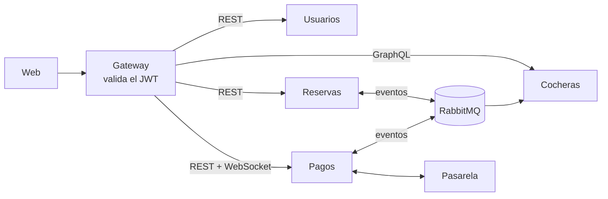

# parkIN

Plataforma distribuida de alquiler de cocheras por franja horaria. Los propietarios publican las cocheras que no usan, y los conductores las buscan en un mapa, las reservan por horas y las pagan, con confirmación en tiempo real. El desafío central es la concurrencia: dos conductores nunca pueden quedarse con la misma cochera en la misma franja.

Proyecto de Sistemas Distribuidos, Universidad de Montevideo (2026). Martina Berrutti, Ignacio Iglesia, Romina Lubniski y Diego Marin.

## Levantar el sistema

Hace falta Docker (con Docker Compose) abierto y corriendo. Node.js solo se necesita para los dos scripts opcionales de más abajo.

```bash
docker compose up --build
```

Con eso alcanza, también la primera vez: las claves de los JWT se generan solas. La primera vez tarda varios minutos porque construye unos 20 contenedores; cuando `docker compose ps` muestra todo en `healthy` (salvo `jwt-claves`, que termina solo), el sistema está listo. Para tener cocheras de ejemplo en el mapa:

```bash
node scripts/sembrar-cocheras.mjs
```

Una vez levantado el sistema, estas direcciones quedan disponibles en tu computadora. Los puertos son fijos, así que tienen que estar libres: si otro programa usa alguno, ese servicio no arranca.

| Qué | Dónde |
|---|---|
| Web | http://localhost:8081 |
| API Gateway | http://localhost:8080 |
| Pasarela de pago de prueba | http://localhost:8090 |
| Grafana (logs, métricas y trazas) | http://localhost:3030 |
| Prometheus (alertas) | http://localhost:9090 |
| Jaeger (trazas) | http://localhost:16686 |
| RabbitMQ | http://localhost:15672 (`guest` / `guest`) |

Para ver la concurrencia en acción: `CONDUCTORES=20 node scripts/demo.mjs`. Veinte conductores reservan la misma franja a la vez, entra uno solo y los demás reciben «franja ocupada». El script paga la reserva ganadora e imprime el enlace a su traza en Jaeger.

## Arquitectura



| Carpeta | Qué es |
|---|---|
| `usuarios/` | Registro, login y sesiones. Node.js, PostgreSQL |
| `cocheras/` | Catálogo y búsqueda geográfica. Node.js, GraphQL, PostGIS, Redis |
| `reservas/` | Reservas sin solapamiento. Python, FastAPI, PostgreSQL |
| `pagos/` | Cobro, reembolsos y avisos en tiempo real. Node.js, Socket.IO, PostgreSQL |
| `pasarela-mock/` | Pasarela de pago simulada para la demo |
| `gateway/` | NGINX con njs: único punto de entrada |
| `web/` | Cliente React |
| `infra/` | RabbitMQ, Prometheus, Grafana, Loki y claves |
| `scripts/` | Datos de demo, demo de concurrencia y prueba con réplicas |

## Documentación

- [`docs/contratos.md`](docs/contratos.md): endpoints, eventos y esquema GraphQL.
