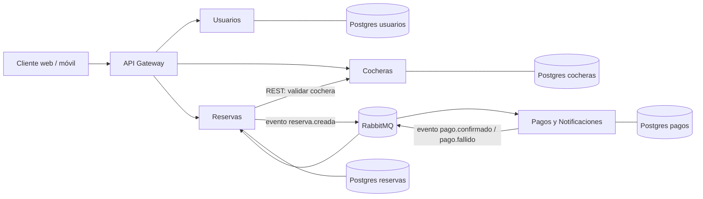

# Arquitectura

Microservicios, elegidos por flexibilidad, escalabilidad y mantenibilidad: cada módulo tiene una responsabilidad y evoluciona de forma independiente.

## Diagrama (borrador)

> Pendiente de decidir: si hay API Gateway o los clientes hablan directo con cada servicio.

## Comunicación (mínimo 2 formas, ver letra §5)

| Mecanismo | Uso | Justificación |
|---|---|---|
| API REST (síncrona) | Cliente → servicios; Reservas → Cocheras (consulta de disponibilidad/precio) | Necesitan respuesta inmediata |
| Mensajería asíncrona (RabbitMQ) | Reservas ↔ Pagos y Notificaciones | Desacopla el cobro, tolera caídas, permite reintentos |

## Flujo principal: reservar y pagar

1. Conductor busca cocheras (Cocheras) y elige una franja.
2. Reservas crea la reserva en estado `PENDIENTE_PAGO` y bloquea la franja (ver concurrencia abajo).
3. Reservas publica `reserva.creada`.
4. Pagos procesa el cobro y publica `pago.confirmado` o `pago.fallido`.
5. Reservas pasa a `CONFIRMADA` (o libera la franja si falló o expiró) y Notificaciones avisa a conductor y propietario.

## Concurrencia (doble reserva)

Propuesta: en la base de Reservas, un *exclusion constraint* de Postgres sobre `(cochera_id, tstzrange(inicio, fin))` con `btree_gist` hace imposible solapar reservas activas aunque dos requests lleguen a la vez. La extensión ya se habilita en `infra/postgres/init.sh`. Registrar la decisión final en un ADR.

## Tecnologías

Por definir. Dejar acá el stack elegido y sus motivos (lenguaje/framework, Postgres, RabbitMQ) y registrar la decisión en `docs/decisiones/`.
