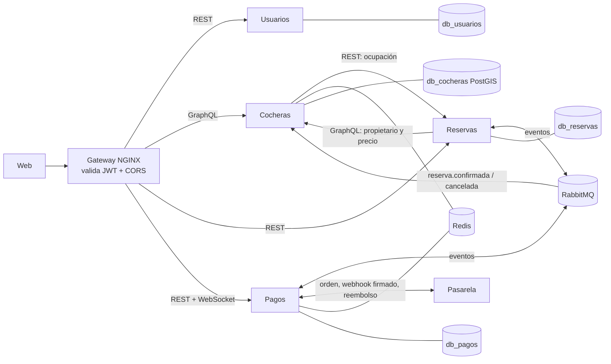
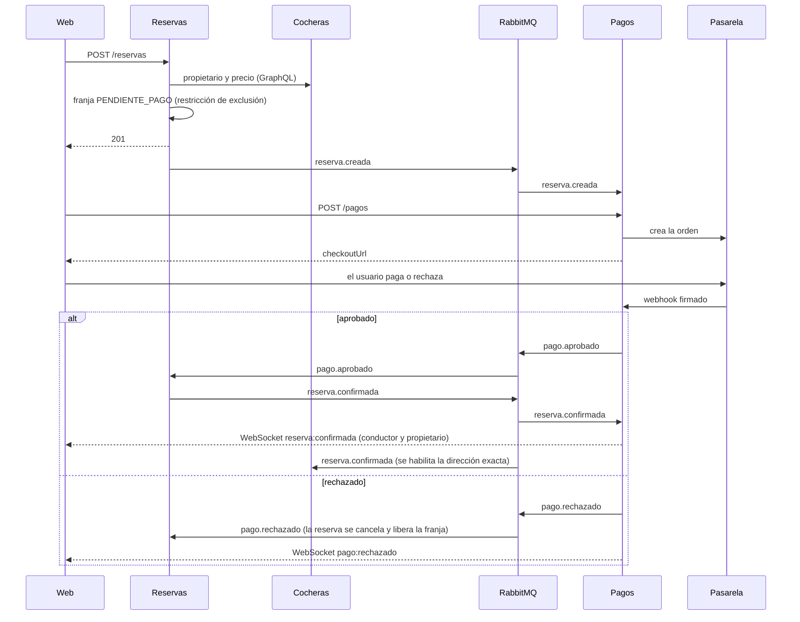

# Arquitectura

Fuente: segunda entrega, actualizada con lo que está implementado. Microservicios orientados a eventos con un API Gateway que valida la identidad, RabbitMQ para el flujo reserva-pago y una base PostgreSQL por servicio (*database per service*: sin JOINs ni claves foráneas entre servicios; las referencias son IDs).

## Componentes

| Carpeta | Stack | Responsabilidad |
|---|---|---|
| `web/` | React 19 + Vite, Tailwind, Leaflet | Único cliente. Solo conoce al gateway. Se despliega en Vercel o como contenedor (`:8081`) |
| `gateway/` | NGINX + njs | Único punto de entrada: valida el JWT, CORS, rate limiting, `traceparent`, ruteo |
| `usuarios/` | Node.js + Express, PostgreSQL | Registro, login, refresh rotativo, perfiles y roles. Emite el JWT (RS256) |
| `cocheras/` | Node.js + Apollo (GraphQL), PostgreSQL + PostGIS, Redis | Alta y gestión de cocheras, disponibilidad semanal, búsqueda por radio con caché |
| `reservas/` | Python 3.12 + FastAPI, PostgreSQL | Reservas: bloqueo de franjas sin solapamientos, retención, cancelación, expiración y finalización |
| `pagos/` | Node.js + Express, Socket.IO, PostgreSQL, Redis | Cobro, webhook, reembolsos y avisos en tiempo real |
| `pasarela-mock/` | Node.js (sin dependencias) | Pasarela de pagos simulada (imita a Mercado Pago) para la demo |

Infraestructura (`docker-compose.yml`): 4 PostgreSQL (el de Cocheras con PostGIS), RabbitMQ (con `infra/rabbitmq/definitions.json`), Redis, y la pila de observabilidad: Prometheus, Loki con Alloy, Jaeger y Grafana. El servicio `jwt-claves` genera el par de claves RS256 la primera vez.

## Diagrama



## Comunicación

| Interacción | Mecanismo | Por qué |
|---|---|---|
| Web → Usuarios, Reservas, Pagos | REST sobre HTTPS | Operaciones simples y fáciles de monitorear por código HTTP |
| Web → Cocheras | GraphQL | Vistas con necesidades de datos muy distintas (mapa vs. ficha) |
| Reservas → Cocheras | GraphQL síncrono | Para crear una reserva hace falta el propietario y el precio, y el conductor espera la respuesta |
| Cocheras → Reservas | REST síncrono | Cocheras consulta la ocupación para filtrar la búsqueda; tolera que falle |
| Reservas ↔ Pagos ↔ Cocheras | RabbitMQ (exchange `cocheras.eventos`) | Desacoplamiento temporal: si un servicio cae, los mensajes esperan en la cola |
| Pagos → web | WebSocket (Socket.IO) | El servidor empuja la confirmación sin polling |
| Pagos ↔ pasarela | REST + webhook firmado (HMAC-SHA256) | La pasarela avisa el resultado por su cuenta |

Endpoints, eventos y esquema: [`contratos.md`](contratos.md).

## Autenticación

1. Usuarios emite un JWT RS256 de 15 minutos (`sub` y `roles`) y un refresh token opaco de un solo uso.
2. El gateway verifica la firma, `exp` y emisor **localmente** con la clave pública, sin llamar a Usuarios en cada request, y pasa la identidad a los servicios en `X-User-Id` y `X-User-Roles`. Descarta siempre lo que el cliente mande en esos headers.
3. Hay rutas públicas (registro, login, webhook de la pasarela), rutas con token obligatorio (Reservas, Pagos, perfil) y una con token opcional (`/graphql`, para poder buscar cocheras sin sesión).
4. Defensa en profundidad: Usuarios y Pagos vuelven a verificar el token. Pagos lo necesita igual para el handshake del WebSocket.
5. **Decisión: se borró `GET /auth/verificar` de Usuarios (26/10).** La primera versión del gateway validaba con `auth_request` contra ese endpoint; cuando pasó a verificar localmente con njs (punto 2), quedó sin uso. Se evaluó dejarlo como alternativa para un NGINX sin njs, pero se borró junto con su métrica y sus tests: un endpoint que nadie llama no se prueba en la práctica y suma superficie de ataque. Si hiciera falta volver a `auth_request`, está en el historial de git (PR #20).

## Flujo principal: reservar y pagar



Casos de falla, todos con compensación:

| Situación | Resultado |
|---|---|
| Pago rechazado | Reservas cancela la reserva y libera la franja |
| Pasa el plazo de 10 minutos sin pago | Reservas la expira (`reserva.expirada`) y Pagos anula el pago pendiente |
| La pasarela cobra cuando la reserva ya expiró o se canceló (pago tardío) | Pagos **reembolsa automáticamente** |
| Se cancela una reserva ya pagada | Pagos reembolsa |
| La pasarela no responde al crear la orden | Se anula ese intento sin cancelar la reserva; se puede volver a pagar |
| Pagos cae | Los eventos esperan en RabbitMQ; al volver, procesa lo pendiente |

## Consistencia y concurrencia

- **Sin dobles reservas:** restricción de exclusión `gist` en la base de Reservas sobre `(cochera_id, franja)` para los estados activos. Las altas de una misma cochera se serializan con un lock de aviso, lo que evita deadlocks entre `INSERT` concurrentes; las cocheras distintas no se bloquean.
- **Idempotencia:** `Idempotency-Key` en las reservas y en los pagos; los consumidores de eventos descartan repetidos por `eventId`; el webhook solo cambia el estado del primer aviso.
- **Outbox transaccional:** Reservas y Pagos guardan el evento en la misma transacción que el cambio de estado y lo publican después con *publisher confirms*. Si RabbitMQ cae, no se pierden eventos.
- **Mensajería:** colas durables *quorum*, ACK manual, 3 reintentos y Dead Letter Queue `cocheras.dlq`.
- **Consistencia eventual:** la búsqueda de Cocheras usa caché y puede mostrar unos segundos una franja recién ocupada; la consistencia fuerte se exige solo al reservar.

## Observabilidad

- **Logs:** JSON a stdout con `traceId`; Alloy los recoge de los contenedores y los manda a Loki.
- **Métricas:** cada servicio expone `/metrics` (Prometheus), con alertas en `infra/prometheus/alertas.yml`.
- **Trazas:** OpenTelemetry a Jaeger. El `traceId` nace en el gateway (header `traceparent`) y viaja por HTTP y dentro de cada evento.
- **Grafana:** tablero técnico y de negocio, con las tres fuentes.
- Todos los servicios exponen `/health` y `/ready`. Detalle en [`observabilidad.md`](observabilidad.md).

## Despliegue

### Levantar el sistema

```bash
docker compose up --build
```

Alcanza también la primera vez: el servicio `jwt-claves` genera las claves de los JWT en `infra/jwt/` si faltan (no se commitean; para regenerarlas, borrar `infra/jwt/*.pem` y volver a levantar). Para cargar cocheras de demo: `node scripts/sembrar-cocheras.mjs`.

| Qué | Dónde |
|---|---|
| Web | http://localhost:8081 |
| API Gateway | http://localhost:8080 |
| Pasarela de pago de prueba | http://localhost:8090 |
| RabbitMQ (gestión) | http://localhost:15672 (`guest` / `guest`) |
| Grafana | http://localhost:3030 |
| Prometheus | http://localhost:9090 |
| Jaeger | http://localhost:16686 |

Los servicios se reinician solos si Docker o la máquina se reinician (`restart: unless-stopped`). Si algún servicio queda caído, `docker compose up -d` lo levanta sin borrar datos, y `docker compose ps` muestra el estado.

### Detalles

Todo el sistema se levanta con `docker compose up --build`. El front puede servirse desde su contenedor o desplegarse en Vercel, en cuyo caso el gateway tiene que ser accesible por HTTPS y permitir ese origen (CORS). La configuración va por variables de entorno (12-Factor); ver [`12-factor.md`](12-factor.md). Para mostrarlo desde otro dispositivo (por ejemplo en la defensa) hay un script que abre un túnel público: ver [`demo-remoto.md`](demo-remoto.md).

## Límites conocidos

- Cocheras y Reservas dependen una de la otra en forma síncrona: sin Cocheras no se pueden crear reservas (`503`); sin Reservas, la búsqueda de Cocheras no filtra por ocupación.
- La política de cancelación todavía no define plazos: se puede cancelar mientras la reserva no haya empezado, y se reembolsa completo.
- La pasarela es simulada: no se mueve dinero real.
- Cocheras no tiene bloqueos de fechas puntuales (solo disponibilidad semanal) ni subida de fotos (se guardan URLs). Las dos cosas quedaron fuera de alcance; el motivo está en `secciones/cocheras.md` §10.
- **Puertos de desarrollo.** El compose publica también los puertos de algunos servicios (Cocheras 4000, Reservas 8000, Pagos 8084, Usuarios 3001) y de las bases de datos, para probarlos sin pasar por el gateway. Como Reservas y Cocheras confían en los headers `X-User-Id` y `X-User-Roles` que pone el gateway, llamándolos directo se podría hacer pasar por otro usuario. En un despliegue real solo se publicaría el gateway (o la web), y las credenciales de desarrollo (`app/app`, `guest/guest`) se reemplazarían por secretos propios.
- Los servicios corren con una sola réplica en el compose; el diseño permite escalar (servicios sin estado, adaptador Redis de Socket.IO, `SKIP LOCKED` en las tareas periódicas), pero no se probó con varias réplicas.
