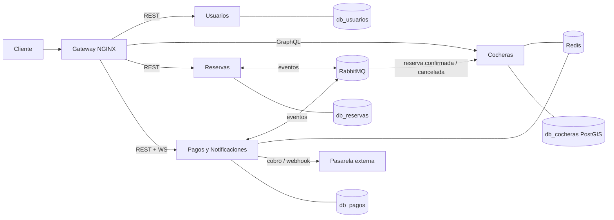

# Arquitectura

Fuente: segunda entrega. Microservicios orientados a eventos con API Gateway, RabbitMQ y una base PostgreSQL por servicio (database per service: sin JOINs ni claves foráneas entre servicios; las referencias son IDs).

## Servicios

| Carpeta | Stack | Responsable |
|---|---|---|
| `gateway/` | NGINX | Romina |
| `usuarios/` | Node.js + Express, PostgreSQL, bcrypt, JWT RS256 | Martina |
| `cocheras/` | Node.js + Apollo (GraphQL), PostgreSQL + PostGIS, Redis | Diego |
| `reservas/` | Python 3.12 + FastAPI, PostgreSQL | Ignacio |
| `pagos/` | Node.js, Socket.IO (adaptador Redis), pasarela externa | Romina |
| `web/` | Cliente web (Vercel) | Martina |

Infra en `docker-compose.yml`: 4 Postgres, RabbitMQ, Redis, Prometheus, Loki, Jaeger, Grafana.

## Diagrama

## Comunicación

| Interacción | Mecanismo |
|---|---|
| Cliente → Usuarios, Reservas, Pagos | REST sobre HTTPS |
| Cliente → Cocheras | GraphQL |
| Reservas ↔ Pagos ↔ Cocheras | RabbitMQ (exchange topic `cocheras.eventos`) |
| Servidor → cliente | WebSocket (Socket.IO) |

El detalle de endpoints, eventos y esquema está en [`contratos.md`](contratos.md).

## Concurrencia

La regla "sin reservas solapadas" vive en la base de Reservas: restricción de exclusión `gist` sobre `(cochera_id, franja)` para estados activos. Retención de 10 minutos, idempotencia con `Idempotency-Key`, control optimista con `version` y saga coreografiada con compensación. Ver la sección 7 de la segunda entrega.
