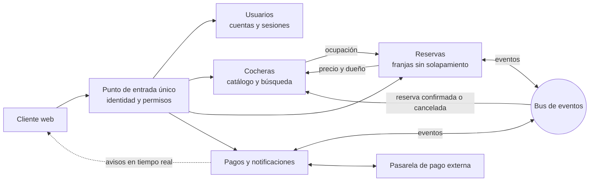

# Diseño

> Borrador para el documento final. Reúne `caracteristicas-sd.md`, `arquitectura.md` y `12-factor.md`, y los relaciona con los conceptos del curso (Van Steen y Tanenbaum, Coulouris). El detalle de cada servicio está en `docs/secciones/`.

## 1. Por qué parkIN es un sistema distribuido

Van Steen y Tanenbaum definen un sistema distribuido como una colección de elementos de cómputo autónomos que se presenta a sus usuarios como un único sistema coherente. parkIN cumple las dos partes:

- **Nodos autónomos:** cuatro servicios de negocio (Usuarios, Cocheras, Reservas y Pagos), cada uno con su propio proceso, su propia base de datos y su propio ciclo de vida. Pueden caerse, reiniciarse o escalar por separado.
- **Un sistema coherente:** quien usa la web ve una sola aplicación («buscar, reservar, pagar») detrás de una sola dirección, el API Gateway, sin saber cuántos servicios hay ni dónde corren.

## 2. Características de los sistemas distribuidos

Las características se definieron en la preentrega a partir del problema. Esta sección explica cómo se aborda cada una y las nombra como en el curso.

### Concurrencia

Es el corazón del problema: varios conductores pueden intentar reservar la misma cochera en la misma franja en el mismo instante, desde distintos dispositivos y contra distintas réplicas del servicio.

- **Consistencia fuerte donde importa.** La base de Reservas tiene una **restricción de exclusión** (`EXCLUDE USING gist` sobre la cochera y el rango horario) que impide que existan dos reservas activas solapadas. Las altas sobre una misma cochera se **serializan** con un lock de PostgreSQL: el resultado es el mismo que si se hubieran ejecutado una después de la otra (*serializability*). La segunda recibe `409`.
- **Probado:** 300 rondas de 10 reservas simultáneas y 60 de 40, siempre con una sola aceptada y ningún error del servidor.
- **Consistencia eventual donde alcanza.** La búsqueda usa una caché de 30 segundos y puede mostrar como libre una franja recién tomada. No produce datos incorrectos, porque el intento de reservarla recibe `409`.
- **Idempotencia:** cada reserva y cada pago llevan una `Idempotency-Key`, así un doble clic o un reintento no crean dos reservas ni cobran dos veces.

### Seguridad

La seguridad se aborda en sus cuatro aspectos:

- **Autenticación.** Usuarios emite un JWT firmado con RS256 y un refresh token de un solo uso; si se reutiliza uno, se cierran todas las sesiones de esa persona (posible robo).
- **Autorización.** El gateway verifica el JWT y pasa la identidad y los roles a los servicios, descartando lo que mande el cliente. Cada servicio controla los permisos: solo el dueño edita su cochera, solo el conductor ve su pago.
- **Confidencialidad.** La dirección de una cochera suele ser la casa del propietario. Todos ven una ubicación aproximada, fija, a 100-300 m de la real; la exacta solo la ven el dueño y el conductor con reserva confirmada. Las contraseñas se guardan con bcrypt, y los logs nunca incluyen contraseñas, tokens ni datos de tarjeta.
- **Integridad.** El precio y el propietario se toman de Cocheras, nunca de lo que mande el cliente. Los cambios de estado son condicionales a la versión. El webhook de la pasarela solo se acepta con una firma HMAC válida.
- **Fallos de seguridad.** Rate limiting en el gateway y validación de entrada en cada servicio. Las alertas detectan fuerza bruta (más de 30 logins fallidos en 5 minutos) y refresh tokens reutilizados.

### Confiabilidad y tolerancia a fallos

Van Steen descompone la confiabilidad (*dependability*) en disponibilidad, fiabilidad, *safety* y mantenibilidad. Coulouris enumera las técnicas para tolerar fallos. parkIN usa estas:

| Técnica | Cómo se aplica |
|---|---|
| Detección | `/health` y `/ready` en cada servicio, healthchecks de Docker y alertas de Prometheus (servicio caído, errores, mensajes en la cola de fallidos) |
| Enmascaramiento | Reintentos de las transacciones abortadas por *deadlock*; reentrega de mensajes no confirmados; reconexión automática a RabbitMQ |
| Tolerancia | Degradación controlada: sin Redis la búsqueda va a la base; sin Reservas, busca sin el filtro de ocupación; sin Pagos, se sigue reservando y los eventos esperan en la cola |
| Recuperación | Compensaciones de la saga: si el pago se rechaza o vence, la reserva se cancela y la franja se libera; si se cobra algo que ya no corresponde, se reembolsa |
| Redundancia | Los eventos se guardan en la base antes de publicarse (*outbox*) y las colas son durables: un evento existe en dos lugares hasta que se confirma |

Con estas técnicas se cubren los tres tipos de falla del curso:
- **Transitorias:** un deadlock o una red lenta se resuelven con un reintento.
- **Intermitentes:** un broker que se cae y vuelve se cubre con reconexión y outbox.
- **Permanentes:** un mensaje que nunca se va a poder procesar va a la cola de mensajes fallidos (*Dead Letter Queue*) en lugar de reintentarse para siempre.

La **mantenibilidad** viene de servicios chicos con una sola responsabilidad, contratos escritos y reinicio automático (`restart: unless-stopped`).

### Disponibilidad

El sistema debe funcionar a toda hora, y sobre todo en las horas pico. Además de la tolerancia a fallos, la mensajería *at-least-once* con ACK manual hace que un servicio caído no pierda trabajo: lo procesa al volver. Si Pagos cae, se pueden seguir creando reservas (está probado).

### Transparencia

Los siete tipos de transparencia de Van Steen, y en qué medida se logran:

| Tipo | En parkIN |
|---|---|
| Acceso | La web usa la misma forma de acceso (HTTP con JSON, o GraphQL) sin importar que detrás haya Node o Python, ni qué base usa cada servicio |
| Ubicación | El cliente conoce una sola URL, la del gateway. Los servicios se ubican entre sí por nombre, no por dirección |
| Reubicación | El gateway vuelve a resolver el nombre de cada servicio cada 10 segundos: si un contenedor se recrea con otra dirección, se lo sigue encontrando |
| Migración | Igual que la reubicación: un servicio sin estado puede levantarse en otro lugar sin que el cliente lo note |
| Replicación | La caché de búsquedas es una copia de los resultados que el usuario no distingue del original. Las réplicas de un servicio comparten cola y caché (el diseño lo permite; se probó con una réplica) |
| Concurrencia | Cada conductor reserva como si estuviera solo; si otro le ganó la franja, solo ve «esa franja acaba de ser reservada» |
| Fallo | El outbox, las colas durables y las compensaciones ocultan la caída de un servicio. Si Pagos cae, el usuario reserva igual |

**Grado de transparencia.** Van Steen advierte que no todo se puede ni conviene ocultar, y en parkIN hay tres cosas que quedan a la vista a propósito:
- **La latencia del pago:** la confirmación llega unos segundos después, por WebSocket, y la reserva se muestra como «retenida» durante hasta 10 minutos.
- **La consistencia eventual de la búsqueda:** hasta 30 segundos.
- **Una falla que no se puede enmascarar:** si Cocheras no responde, no se pueden crear reservas (`503`), porque hace falta el precio.

Ocultarlas tendría un costo mayor que mostrarlas.

### Heterogeneidad

Reservas está en Python y el resto de los servicios en Node.js. Las bases son las mismas en motor, pero independientes. Se integran porque se hablan por protocolos estándar (HTTP, GraphQL, AMQP, WebSocket) con los contratos escritos en `docs/contratos.md`. El **middleware** que enmascara esa heterogeneidad es el gateway (para el cliente) y RabbitMQ (entre servicios). La web es *responsive* y funciona igual en computadora y en celular.

### Apertura

Van Steen pide interfaces completas y neutras: que describan todo lo necesario para usar un componente sin depender de cómo está hecho.

- **Las interfaces de parkIN cumplen eso:** `docs/contratos.md` define cada endpoint, cada evento y el esquema GraphQL antes de implementar, y cualquier cliente que hable HTTP puede usar la misma API que la web.
- **Interoperabilidad:** Python y Node conviven sin adaptadores.
- **Portabilidad:** todo corre en contenedores.
- **Políticas separadas de mecanismos:** por ejemplo, el tiempo de la caché, el plazo de retención y los límites de las alertas son configuración, no código.

### Extensibilidad

Con un exchange de tipo *topic*, un servicio nuevo se suscribe a los eventos que le interesan sin cambiar a quien los publica (por ejemplo, un servicio de calificaciones que escuche `reserva.confirmada`; Reservas ya marca las reservas finalizadas y dejó previsto publicar `reserva.finalizada` cuando haya un consumidor). El tipo de vehículo es un enum que se amplía en el contrato (motos, bicicletas). Un medio de pago nuevo se agrega dentro de Pagos sin tocar Reservas, que solo escucha `pago.aprobado` y `pago.rechazado`.

### Escalabilidad

parkIN apunta a **escalabilidad en tamaño**: más cocheras, más usuarios y picos de demanda (Punta del Este en verano). Usa las tres técnicas del curso:

- **Ocultar latencias:** comunicación asincrónica entre Reservas y Pagos; el conductor no espera a la pasarela para tener su franja retenida.
- **Particionar y distribuir:** cada servicio con su base (*database per service*), que escala por separado.
- **Replicar:** caché de búsquedas en Redis e índice geográfico. Los servicios no guardan estado en memoria, así que escalan agregando réplicas.

La replicación trae inconsistencia, y lo aceptamos solo en la búsqueda (30 segundos de caché), nunca en la reserva ni en el pago. Las métricas de escalabilidad del curso (*throughput* y tiempo de respuesta) se miden en Grafana: requests por segundo y latencia p95 por servicio.

**Límite:** el diseño permite varias réplicas, pero solo se probó con una de cada servicio.

### Calidad de servicio

La latencia p95 es el indicador de calidad de servicio: hay alertas si la búsqueda o el login superan 500 ms, o si crear una reserva supera 800 ms, durante 5 minutos.

## 3. Arquitectura

### Estilos

parkIN combina tres estilos de los vistos en el curso:

- **Microservicios** (la evolución de la arquitectura orientada a servicios): cada servicio es un proceso separado, con una responsabilidad del dominio y su propia base. No comparten base de datos: las referencias entre servicios son solo identificadores.
- **Publicación-suscripción orientada a eventos** para el flujo de reserva y pago. Los servicios están **desacoplados por referencia** (quien publica no sabe quién escucha) y, gracias a las colas durables, también **en el tiempo**: un evento espera a que su consumidor vuelva.
- **Cliente-servidor** entre la web y el gateway, y entre servicios cuando la respuesta hace falta en el momento (Reservas le pide el precio a Cocheras).

Dentro de cada servicio hay **capas**: rutas o resolvers, lógica de negocio y acceso a datos.

### Organización lógica

El diagrama general muestra los componentes y cómo se relacionan, sin tecnologías:

| Componente | Por qué existe |
|---|---|
| Punto de entrada único | Concentra la autenticación, el rate limiting y la trazabilidad, y oculta la ubicación de los servicios |
| Usuarios | Único que conoce contraseñas y firma tokens. Aislarlo reduce la superficie de ataque |
| Cocheras | El catálogo se lee mucho más de lo que se escribe; la búsqueda geográfica y su caché escalan aparte |
| Reservas | Es el único dueño de la regla «nunca dos reservas solapadas», y la hace cumplir en un solo lugar |
| Pagos y notificaciones | Aísla la integración con la pasarela externa y las conexiones en tiempo real con los clientes |
| Bus de eventos | Coordina reserva y pago sin que un servicio tenga que estar disponible cuando el otro lo necesita |

### Organización física

En la entrega, todo corre en una sola máquina con Docker Compose: un contenedor por servicio, una base PostgreSQL por servicio (la de Cocheras con PostGIS), RabbitMQ, Redis y la pila de observabilidad. Solo el gateway (y la web) deberían quedar publicados hacia afuera. El diagrama con las tecnologías está en `docs/arquitectura.md`.

**Límite:** el compose de desarrollo también publica los puertos de algunos servicios para probarlos directo, y en un despliegue real se cerrarían.

### Flujo principal: reservar y pagar

1. El conductor reserva; Reservas le pide a Cocheras el precio y el dueño, y crea la reserva en `PENDIENTE_PAGO`. La restricción de exclusión garantiza que gane uno solo.
2. Reservas publica `reserva.creada`; Pagos la recibe.
3. El conductor paga en la pasarela, y la pasarela avisa a Pagos con un webhook firmado.
4. Pagos publica `pago.aprobado`; Reservas confirma y publica `reserva.confirmada`. Cocheras habilita la dirección exacta para ese conductor, y Pagos avisa por WebSocket al conductor y al propietario.
5. Si el pago se rechaza o pasan 10 minutos, la reserva se cancela o expira y la franja se libera.

El diagrama de secuencia completo, con los casos de falla, está en `docs/arquitectura.md`.

### Cambios desde las entregas anteriores

| Antes (preentrega o segunda entrega) | Implementado | Por qué |
|---|---|---|
| La búsqueda y el *matching* estaban en Reservas | La búsqueda pasó a Cocheras, que consulta la ocupación a Reservas | La búsqueda es sobre el catálogo (ubicación, tipo, disponibilidad semanal) y necesita su índice geográfico y su caché; Reservas se quedó solo con la regla de no solapamiento |
| El gateway le preguntaba a Usuarios si cada token era válido (primera versión del gateway) | El gateway verifica el JWT localmente con la clave pública | Evita una llamada a Usuarios en cada request y que Usuarios sea un punto único de falla |
| Clientes iOS, Android y web | Una web *responsive* | Con el tiempo de la entrega, una sola web que funciona en el celular cubre los dos roles |

### Ventajas y desventajas de la arquitectura elegida

**Ventajas**
- Cada servicio escala, falla y evoluciona por separado. La caída de Pagos no impide reservar.
- La regla crítica (no solapar) vive en un solo lugar y se cumple aunque haya varias réplicas.
- Sumar funcionalidades por eventos no obliga a tocar lo que existe.

**Desventajas**
- **Más piezas que operar:** 4 bases, un broker, una caché y la observabilidad. Sin trazas distribuidas, diagnosticar un error sería mucho más difícil.
- **No hay transacciones entre servicios:** reservar y pagar se coordina con una saga, que es más compleja que una transacción local y obliga a pensar cada compensación.
- **Dependencias síncronas:** quedan dos (Reservas a Cocheras y Cocheras a Reservas), y sin Cocheras no se puede reservar.

## 4. Coordinación

### Exclusión mutua

Que dos conductores no tomen la misma franja es un problema de **exclusión mutua distribuida**: la franja es el recurso y reservarla es la sección crítica. Lo resolvemos con el esquema de **servidor central** del curso, donde la base de datos de Reservas hace de coordinador. Todas las réplicas le piden permiso al mismo lugar:
- un lock por cochera que hace fila con las altas de esa cochera;
- la restricción de exclusión, que rechaza cualquier solapamiento.

Las dos propiedades que pide el curso se cumplen:
- **Seguridad:** nunca hay dos reservas en la sección crítica, es decir, nunca dos reservas solapadas.
- **Pervivencia:** el lock se libera solo al terminar la transacción, aunque el proceso muera, y una transacción abortada se reintenta hasta 3 veces antes de responder `503`, así que nadie espera para siempre.

El punto único de falla del servidor central es aceptable acá, porque si la base de Reservas no está, no hay reservas que proteger.

### Tiempo y relojes

El sistema evita depender del orden temporal entre nodos:

- **Una sola referencia de tiempo:** todas las horas se guardan en UTC, y el vencimiento de una reserva lo decide la base de Reservas comparando con su propio reloj (`now()`), no el reloj de cada réplica.
- **Los relojes de las máquinas:** en el compose, todos los contenedores comparten el reloj del host. Con varias máquinas haría falta sincronizarlas con NTP.
- **El orden de los eventos no se deduce de su hora.** Los eventos llevan su momento (`ocurridoEn`), pero ningún consumidor lo usa para ordenarlos, porque con relojes distintos esa hora no es confiable. En su lugar:
  - cada evento repetido se descarta por su `eventId`;
  - cada cambio de estado es condicional al estado actual;
  - un evento fuera de orden no puede deshacer uno posterior. Por ejemplo, si la cancelación le llega a Cocheras antes que la confirmación, el acceso queda revocado.

El efecto es el mismo que buscan los relojes lógicos de Lamport (respetar la relación «sucede antes»), pero lo garantiza el estado guardado y no una marca de tiempo.

### Saga en lugar de transacción distribuida

Reservar y pagar ocurre en dos servicios con bases distintas, así que no hay una transacción que abarque a los dos. En lugar de un protocolo de acuerdo entre servicios (como un *commit* en dos fases), usamos una **saga coreografiada**: cada paso es una transacción local que publica un evento, y si un paso falla se ejecuta una compensación. El sistema queda consistente al final (consistencia eventual), sin bloquear recursos de un servicio mientras espera a otro, y sin que una caída deje a los demás trabados.

**Por qué no un coordinador externo (como ZooKeeper).** El único recurso que necesita exclusión mutua es la franja, y su dueño natural, la base de Reservas, ya ofrece los locks y las restricciones necesarias. Un coordinador aparte sumaría otra pieza que operar sin resolver nada que la base no resuelva.

## 5. Metodología 12-Factor

| Factor | Cómo se aplica |
|---|---|
| I. Código base | Un repositorio con una carpeta y una imagen por servicio; el mismo código se despliega en cualquier entorno |
| II. Dependencias | Declaradas y con versión fija (`package-lock.json` y `requirements.txt`); las imágenes no usan nada de la máquina |
| III. Configuración | Solo variables de entorno, con un `.env.example` por servicio. No hay secretos en el repositorio |
| IV. Servicios de respaldo | PostgreSQL, RabbitMQ, Redis y Jaeger se ubican por URL; cambiarlos es cambiar una variable. Cocheras funciona sin Redis |
| V. Construir, distribuir, ejecutar | Un `Dockerfile` por servicio (build), la imagen más la configuración del compose (release) y el contenedor (run) |
| VI. Procesos | Sin estado en memoria entre requests: todo va a PostgreSQL, Redis o RabbitMQ |
| VII. Asignación de puertos | Cada servicio expone su propio puerto HTTP; el gateway los publica hacia afuera |
| VIII. Concurrencia | Se escala agregando réplicas; los consumidores compiten por la misma cola y las migraciones toman un lock para no correr dos veces |
| IX. Desechabilidad | Arranque en segundos y apagado ordenado con `SIGTERM`; con ACK manual, un mensaje a medio procesar se reentrega |
| X. Paridad desarrollo/producción | `docker compose up` levanta los mismos servicios de respaldo y versiones que se usarían en producción, sin sustitutos como SQLite |
| XI. Logs | JSON a la salida estándar; el entorno los recolecta y los manda a Loki |
| XII. Procesos de administración | **Parcial.** Las migraciones son SQL versionado y corren con el mismo código y configuración, pero al arrancar el servicio y no como un proceso aparte |

El detalle por factor está en `docs/12-factor.md`.
