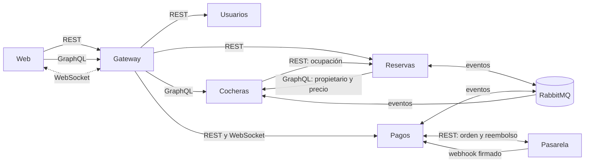

# Comunicación

> Borrador para el documento final. Pasa a la forma del informe lo que está en `docs/contratos.md` (endpoints, eventos y mensajes) y en `docs/arquitectura.md`. Cada afirmación sale de lo que está implementado.

La letra pide al menos dos formas de comunicación y que se justifique cada una. parkIN usa **cuatro**: REST, GraphQL, mensajería con RabbitMQ y WebSocket. Además, la pasarela de pagos se comunica con Pagos mediante un **webhook** firmado, que es REST en el sentido inverso. Ninguna se eligió por uniformidad: cada una responde a un caso de uso distinto.

## La regla que seguimos

> **Síncrono cuando quien llama necesita la respuesta ya; asíncrono cuando no.**

Para crear una reserva hace falta saber quién es el propietario y cuál es el precio, y el conductor espera la respuesta: eso es una llamada síncrona. Confirmar un pago, en cambio, no necesita que nadie espere: el conductor no se queda mirando mientras la pasarela cobra y Reservas actualiza su estado. Eso viaja como evento.

En los términos de Kleppmann, que vimos en el curso, hay tres modos de que los datos fluyan entre procesos. parkIN usa dos y descarta uno a propósito:

| Modo | En parkIN |
|---|---|
| A través de la base de datos | **No se usa entre servicios.** Cada servicio tiene su propia base y nadie lee la de otro (*database per service*). Una base compartida acoplaría los esquemas: un cambio en una tabla rompería a otro servicio, y una base caída tiraría abajo a todos |
| A través de servicios (REST, GraphQL) | Web con los servicios, y Reservas con Cocheras. Síncrono: se espera la respuesta |
| Paso de mensajes asíncrono | RabbitMQ entre Reservas, Pagos y Cocheras |

## Vista general

## Los cuatro mecanismos

| Mecanismo | Entre quiénes | Por qué se eligió | Caso de uso |
|---|---|---|---|
| **REST sobre HTTP** | Web con Usuarios, Reservas y Pagos | Operaciones simples sobre recursos, fáciles de monitorear por código de estado y de reintentar con una clave de idempotencia | Registrarse, crear y cancelar una reserva, iniciar un pago |
| **GraphQL** | Web con Cocheras; Reservas con Cocheras | Cada pantalla necesita datos distintos de la misma cochera: el mapa pide pocos campos de muchas cocheras y la ficha pide muchos de una sola. El cliente pide exactamente lo que necesita en un solo pedido | Buscar cocheras en el mapa, ver la ficha, publicar una cochera |
| **Mensajería (RabbitMQ, AMQP)** | Reservas, Pagos y Cocheras entre sí | Desacoplamiento en el tiempo: si un servicio cae, los mensajes esperan en la cola y no se pierde el trabajo. Un servicio nuevo se suscribe sin tocar a quien publica | La saga de reserva y pago |
| **WebSocket (Socket.IO)** | Pagos hacia la web | El servidor empuja el aviso en el momento en que ocurre, sin que el cliente pregunte | «Tu reserva está confirmada» sin recargar la página |

### REST

La web habla con Usuarios, Reservas y Pagos por HTTP con JSON, siempre a través del gateway: el cliente llama `/api/reservas/...` y el servicio recibe `/reservas/...`. Se usan los verbos y los códigos de estado con su significado:

- `201` cuando se crea una reserva o un pago, `409` cuando la franja ya está ocupada, `401` sin token y `403` con un token válido pero sin permiso, `429` cuando se supera el límite de pedidos y `503` con `Retry-After` cuando una dependencia no está disponible.
- `POST /reservas` y `POST /pagos` exigen el header **`Idempotency-Key`**. `POST` no es idempotente por definición: si la respuesta se pierde y el cliente reintenta, sin la clave se crearían dos reservas o dos cobros. Con la clave, el segundo intento devuelve lo ya creado.
- No hay sesión en el servidor: el token de identidad viaja en `Authorization` en cada pedido.

### GraphQL

Cocheras expone un único endpoint (`POST /graphql`) con consultas (`buscarCocheras`, `cochera`, `misCocheras`) y mutaciones (`crearCochera`, `actualizarCochera`, `definirDisponibilidad`, `eliminarCochera`). Dos decisiones de diseño lo hacen seguro y rápido: la profundidad máxima de una consulta es 5, para frenar consultas maliciosas, y DataLoader agrupa las consultas repetidas para evitar el problema N+1. Como GraphQL responde `200` aun con errores, cada operación se mide con su resultado y hay una alerta sobre las que fallan.

Se usa solo en Cocheras porque es el único servicio donde el cliente necesita formas de respuesta muy distintas. En Usuarios, Reservas y Pagos las respuestas son pequeñas y fijas, y REST alcanza.

### Mensajería con RabbitMQ

Reservas, Pagos y Cocheras se avisan lo que pasa con **eventos** publicados en un *exchange* de tipo *topic* llamado `cocheras.eventos`. Cada servicio tiene su propia cola y se suscribe solo a los eventos que le interesan.

| Evento | Lo publica | Lo consumen | Efecto |
|---|---|---|---|
| `reserva.creada` | Reservas | Pagos | Pagos queda listo para cobrar esa reserva |
| `pago.aprobado` | Pagos | Reservas | La reserva pasa a `CONFIRMADA` |
| `pago.rechazado` | Pagos | Reservas | La reserva se cancela y se libera la franja |
| `reserva.confirmada` | Reservas | Pagos, Cocheras | Aviso en tiempo real; Cocheras habilita la dirección exacta y limpia su caché |
| `reserva.cancelada` | Reservas | Pagos, Cocheras | Reembolso si corresponde, aviso y limpieza de caché |
| `reserva.expirada` | Reservas | Pagos | Se anula el pago pendiente y se avisa al conductor |

Todos los mensajes tienen la misma forma: un `eventId` único, el `tipo`, la fecha, el `traceId` y los `datos`. Las colas son:

| Cola | La consume | Eventos |
|---|---|---|
| `reservas.pago-eventos` | Reservas | `pago.aprobado`, `pago.rechazado` |
| `pagos.reserva-eventos` | Pagos | `reserva.creada`, `reserva.confirmada`, `reserva.cancelada`, `reserva.expirada` |
| `cocheras.reserva-eventos` | Cocheras | `reserva.confirmada`, `reserva.cancelada` |
| `cocheras.dlq` | Nadie: se inspecciona a mano | Lo que superó 3 entregas |

**Garantías.** La mensajería no es confiable por sí sola; se la hace confiable con cuatro piezas que se combinan:

1. **Outbox transaccional.** Reservas y Pagos guardan el evento en su propia base, en la misma transacción que el cambio de estado, y un publicador aparte lo envía después con *publisher confirms*. Así no hay cambio sin evento ni evento sin cambio, y si RabbitMQ está caído el evento espera.
2. **Colas durables (*quorum*) y ACK manual.** Un mensaje solo sale de la cola cuando el consumidor confirma que lo procesó. Si el consumidor muere a mitad, RabbitMQ lo reentrega.
3. **Reintentos y Dead Letter Queue.** Un mensaje que falla se reintenta hasta 3 veces y después va a `cocheras.dlq`, donde dispara una alerta. Un mensaje roto, que nunca se podrá procesar, va directo ahí.
4. **Consumidores idempotentes.** La entrega es *at-least-once*: un mensaje puede llegar repetido. Cada consumidor guarda el `eventId` que ya procesó y descarta los repetidos.

El resultado es que «nada se pierde y nada se aplica dos veces» es una propiedad del diseño y no una aspiración.

**Por qué RabbitMQ y no Kafka.** Lo que necesitamos es repartir cada evento a las colas que lo escuchan, con confirmación por mensaje, reintentos y una cola de mensajes fallidos. No necesitamos un registro histórico de eventos ni un volumen alto. RabbitMQ trae todo eso incorporado y es más simple de operar.

### WebSocket

El WebSocket va de Pagos a la web, y se usa para un solo propósito: avisar en el momento que una reserva se confirma, se cancela o vence, o que un pago se rechaza. Se implementa con Socket.IO, que agrega reconexión automática y salas.

- **Autenticación en el *handshake*.** El navegador no puede mandar headers personalizados en un WebSocket, así que el token viaja en la conexión y Pagos lo verifica con la clave pública. Un token falso se rechaza con `TOKEN_INVALIDO`.
- **Salas por usuario.** Cada conexión entra a la sala `user:{id}`. Cada aviso se emite a la sala del destinatario: nadie recibe avisos de reservas ajenas, y si el usuario tiene varias pestañas abiertas, le llegan a todas.
- **Varias réplicas.** El adaptador de Redis reparte cada aviso entre réplicas de Pagos: llega aunque el cliente esté conectado a otra instancia. Se probó con 2 réplicas de Pagos: el conductor conectado a una y el propietario conectado a la otra recibieron los 10 avisos de confirmación, aunque el evento lo consumiera cualquiera de las dos. Si Redis no responde al arrancar, Pagos arranca igual sin el adaptador.
- **Es un aviso, no la fuente de verdad.** Si el usuario estaba desconectado, no se pierde información: la reserva se consulta por REST. La pantalla además consulta el estado cada 5 segundos mientras la reserva espera el pago, como respaldo.

Frente a las alternativas: con *polling* solo, el aviso tarda lo que tarde la próxima consulta y cada pestaña carga al servidor; con *Server-Sent Events* alcanzaría para avisos en un solo sentido, pero Socket.IO trae reconexión y salas por usuario.

### El webhook de la pasarela

Cuando el usuario paga, la pasarela avisa a Pagos con una llamada HTTP a `POST /pagos/webhook`. Esa llamada **no lleva token de usuario**, porque no la hace una persona, así que se autentica de otra manera: la pasarela firma el cuerpo con **HMAC-SHA256** y un secreto compartido, y Pagos la verifica antes de hacer nada. Sin firma válida responde `401` y no cambia el pago.

Como las pasarelas reintentan sus avisos, el webhook es **idempotente**: solo el primer aviso de un pago pendiente cambia su estado; los siguientes se responden con `200` para que dejen de reintentar. La pasarela simulada reintenta hasta 4 veces, con espera creciente.

## Cómo viaja una reserva de punta a punta

Para ver los cuatro mecanismos juntos, este es el recorrido de una reserva que se paga:

1. La web crea la reserva por **REST** (`POST /api/reservas`) con una `Idempotency-Key`.
2. Reservas pregunta a Cocheras el propietario y el precio por **GraphQL**, de forma síncrona.
3. Reservas guarda la reserva y publica `reserva.creada` por **RabbitMQ**.
4. La web inicia el pago por **REST** (`POST /api/pagos`). Pagos crea la orden en la pasarela y devuelve la dirección de pago.
5. El usuario paga en la pasarela, que avisa a Pagos por **webhook**.
6. Pagos publica `pago.aprobado`; Reservas confirma y publica `reserva.confirmada`, por **RabbitMQ**.
7. Pagos avisa a conductor y propietario por **WebSocket**, y Cocheras habilita la dirección exacta.

Un mismo identificador de traza (`traceId`) recorre los pasos: nace en el gateway, viaja en los headers HTTP y dentro de cada evento, y permite seguir la reserva completa en Jaeger.

## Qué pasa cuando algo falla

| Falla | Efecto |
|---|---|
| Pagos se cae | Reservas sigue aceptando reservas. Los eventos esperan en la cola y se procesan cuando Pagos vuelve |
| RabbitMQ se cae | Los servicios siguen respondiendo pedidos. Los eventos esperan en el *outbox* y se publican al volver |
| Reservas se cae | La búsqueda de cocheras sigue funcionando, sin filtrar por ocupación. No se pueden crear reservas |
| Cocheras se cae | No se pueden crear reservas (`503`): Reservas necesita el precio y el propietario |
| Se pierde un aviso por WebSocket | La pantalla se actualiza igual con la consulta periódica |
| La pasarela no responde | Se anula ese intento de pago; la reserva se puede volver a pagar |

## Límites

- **Reservas y Cocheras dependen la una de la otra en forma síncrona.** Es el acoplamiento más fuerte que quedó: sin Cocheras no se crean reservas. Se aceptó porque el conductor espera esa respuesta y el precio no puede venir del cliente.
- **El contexto de traza viaja solo como `traceId` dentro de los eventos**, no como el `traceparent` completo, y el gateway no aparece como un tramo en las trazas. En Jaeger, algunos tramos muestran un aviso de padre desconocido.
- **La entrega de eventos es *at-least-once***, no exactamente una vez: la idempotencia de los consumidores es lo que lo compensa.
- **El WebSocket se probó con 2 réplicas de Pagos**, no con más ni con carga sostenida.
