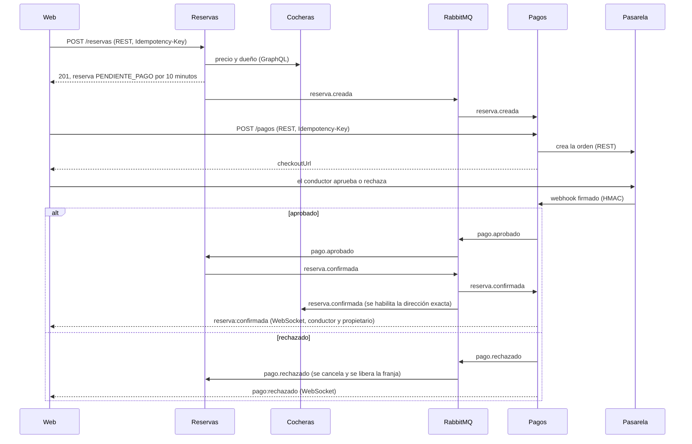

# Comunicación

> Borrador para el documento final. Reúne lo que está en `contratos.md` (endpoints, eventos y esquema) y en `arquitectura.md`, y lo explica con los conceptos del curso. El detalle de cada servicio está en `docs/secciones/`.

La letra pide al menos dos formas de comunicación. parkIN usa cuatro: **REST**, **GraphQL**, **mensajería con RabbitMQ** y **WebSocket**. Elegimos cada una por el caso de uso, no por variedad: cada interacción usa la que mejor resuelve lo que necesita.

## 1. Quién habla con quién

| Interacción | Mecanismo | Síncrono | Por qué |
|---|---|---|---|
| Web → Usuarios, Reservas, Pagos | REST | Sí | Operaciones simples (registrarse, reservar, pagar) que se entienden y se monitorean por código HTTP |
| Web → Cocheras | GraphQL | Sí | El mapa, la ficha y el panel del propietario necesitan datos muy distintos de la misma cochera |
| Reservas → Cocheras | GraphQL | Sí | Para crear la reserva hacen falta el precio y el dueño, y el conductor está esperando la respuesta |
| Cocheras → Reservas | REST | Sí | La búsqueda consulta la ocupación de cada candidata; si falla, la búsqueda sigue sin ese filtro |
| Reservas ↔ Pagos, y los dos → Cocheras | RabbitMQ | No | Coordinar reserva y pago sin que un servicio tenga que estar vivo cuando el otro lo necesita |
| Pagos → web | WebSocket (Socket.IO) | No | El servidor avisa la confirmación apenas ocurre, sin que el cliente pregunte |
| Pagos ↔ pasarela | REST y webhook firmado | Sí | Pagos crea la orden; la pasarela avisa el resultado cuando lo tiene |

Todo lo que entra desde afuera pasa por el **gateway** (`:8080`), que valida el token, aplica rate limiting y genera el `traceId`. Las llamadas entre servicios (Reservas con Cocheras, Pagos con la pasarela) van directo por la red interna de Docker, por nombre de servicio.

## 2. Síncrono o asíncrono

Kleppmann distingue tres modos de flujo de datos entre procesos. parkIN usa dos, y descarta el tercero a propósito:

| Modo | En parkIN |
|---|---|
| A través de la base de datos | **No se usa.** Cada servicio tiene su base (*database per service*); compartirla acoplaría los esquemas, y una base caída tiraría a todos |
| A través de servicios (REST, GraphQL) | La web con cada servicio, y Reservas con Cocheras |
| Paso de mensajes asíncrono | RabbitMQ entre Reservas, Pagos y Cocheras |

La regla que seguimos:
- **Síncrono cuando el usuario necesita la respuesta ya.** Para crear una reserva hace falta el precio, así que Reservas se lo pide a Cocheras y espera.
- **Asíncrono cuando no.** Confirmar el pago puede tardar unos segundos, y no hace falta que Reservas y Pagos estén vivos al mismo tiempo.

El costo de lo síncrono es el **acoplamiento en el tiempo**: si Cocheras no responde, no se pueden crear reservas (`503`). Por eso cada llamada síncrona entre servicios tiene un límite de espera, para que una dependencia lenta no deje a nadie esperando para siempre:

| Llamada | Límite | Si falla |
|---|---|---|
| Reservas → Cocheras (precio y dueño) | 3 s | `503`; reintentar con la misma `Idempotency-Key` no vuelve a consultar a Cocheras si la reserva ya se creó |
| Cocheras → Reservas (ocupación) | 2 s | La búsqueda devuelve las cocheras sin filtrar, y ese resultado no se guarda en la caché |
| Pagos → pasarela (crear la orden) | 5 s | `503 PASARELA_NO_DISPONIBLE`; el intento se anula y se puede volver a pagar |
| Pasarela → Pagos (webhook) | 5 s por intento | Hasta 4 intentos con espera creciente (400, 800 y 1600 ms) |

## 3. REST

Usuarios, Reservas y Pagos exponen APIs REST con JSON. Seguimos las convenciones del curso:

- **Recursos con sustantivos**, sin verbos en la URL: `/reservas`, `/reservas/{id}`, `/pagos/{id}`.
- **Sin estado:** el JWT viaja en `Authorization` en cada request; ningún servicio guarda sesión.
- **Los métodos respetan su semántica.** `GET` es seguro e idempotente. `POST` no es idempotente, así que `POST /reservas` y `POST /pagos` exigen una `Idempotency-Key`: si la respuesta se pierde y el cliente reintenta, recibe lo mismo en lugar de crear una segunda reserva o un segundo cobro.
- **Los códigos HTTP dicen qué pasó:**

| Código | Cuándo |
|---|---|
| `201` / `200` | Creado / ya existía (mismo pedido repetido) |
| `401` / `403` | Sin token o token inválido (autenticación) / token válido pero sin permiso, como `NO_ES_TU_RESERVA` (autorización) |
| `404` | Recurso inexistente |
| `409` | Conflicto: franja ocupada, pago ya en curso o clave de idempotencia usada para otra cosa |
| `422` | Datos con formato inválido |
| `429` | Rate limiting del gateway |
| `503` | Una dependencia no responde (Cocheras, la pasarela) |

Por qué REST en estos tres servicios: son operaciones puntuales sobre un recurso, y REST es el más fácil de monitorear (una métrica por ruta y código) y de cachear por HTTP.

**El webhook de la pasarela** es la única ruta REST que no lleva token, porque no la llama una persona sino la pasarela. En su lugar, cada aviso lleva una firma HMAC-SHA256 del cuerpo con un secreto compartido. Pagos la verifica antes de leer el contenido y descarta los avisos repetidos. El gateway la deja pasar sin JWT, y la firma la valida Pagos.

## 4. GraphQL

Cocheras expone un único endpoint, `POST /graphql`, con un esquema tipado (queries `buscarCocheras`, `cochera` y `misCocheras`; mutations para crear, editar, definir disponibilidad y eliminar).

**Por qué en Cocheras y solo en Cocheras.** Es el único servicio cuyas pantallas necesitan datos muy distintos de la misma entidad. El mapa pide 5 campos de muchas cocheras; la ficha pide horarios, fotos y dirección de una; el panel del propietario, otros. Con REST habría que elegir entre traer de más (*over-fetching*), hacer varias llamadas (*under-fetching*) o crear un endpoint por pantalla. Con GraphQL cada pantalla pide exactamente lo que dibuja, en una sola request. Reservas y Pagos no tienen ese problema.

GraphQL trae sus propios riesgos, y cada uno tiene su respuesta:

| Riesgo | Cómo se resuelve |
|---|---|
| Problema N+1: 50 cocheras con su disponibilidad serían 51 consultas | DataLoader agrupa las consultas repetidas de un mismo pedido: quedan 2. Un test lo verifica contando las consultas |
| Queries maliciosas, anidadas sin fin | Profundidad máxima 5 |
| Los errores vuelven con HTTP `200` y no se ven en las métricas por código | Se mide cada operación con su resultado (`ok`, `error_cliente`, `error_interno`), y hay una alerta |
| No se puede cachear por HTTP (todo es `POST`) | La caché se hace en el servidor: Redis, 30 segundos, con los argumentos de la búsqueda como clave |

Reservas también usa GraphQL como cliente: le pide a Cocheras `cochera(id) { propietario { id } precioHora }`. El precio y el dueño nunca se toman de lo que manda el conductor.

## 5. Mensajería con RabbitMQ

Reservar y pagar se coordina con eventos sobre un exchange de tipo **topic**, `cocheras.eventos`. Quien publica no sabe quién escucha (**desacoplamiento por referencia**), y como las colas son durables, el consumidor no tiene que estar vivo cuando se publica (**desacoplamiento en el tiempo**).

| Evento | Publica | Consumen | Efecto |
|---|---|---|---|
| `reserva.creada` | Reservas | Pagos | Pagos guarda una copia de la reserva y queda listo para cobrarla |
| `pago.aprobado` | Pagos | Reservas | La reserva pasa a `CONFIRMADA` |
| `pago.rechazado` | Pagos | Reservas | La reserva se cancela y libera la franja (compensación) |
| `reserva.confirmada` | Reservas | Pagos, Cocheras | Aviso en vivo al conductor y al propietario; Cocheras habilita la dirección exacta |
| `reserva.cancelada` | Reservas | Pagos, Cocheras | Reembolso si ya se había cobrado, aviso y revocación del acceso |
| `reserva.expirada` | Reservas | Pagos | Pagos anula el pago pendiente y avisa al conductor |

Cada servicio consume de **su propia cola** (`pagos.reserva-eventos`, `reservas.pago-eventos`, `cocheras.reserva-eventos`), suscripta solo a las claves que le interesan. Un mismo evento, como `reserva.confirmada`, llega a dos colas. La topología la define RabbitMQ al arrancar (`infra/rabbitmq/definitions.json`); los servicios no declaran colas.

Todos los eventos tienen la misma forma: `eventId`, `tipo`, `ocurridoEn`, `traceId` y `datos`.

### Garantías

La mensajería se diseñó para que **nada se pierda y nada se aplique dos veces**:

- **Outbox transaccional.** Reservas y Pagos guardan el evento en la misma transacción que el cambio de estado. Un publicador aparte lo envía después, con *publisher confirms* y `mandatory`, y lo marca como enviado solo cuando el broker lo confirma. Si RabbitMQ está caído, el evento espera en la tabla y sale cuando vuelve. Sin esto, una caída entre «guardar» y «publicar» dejaría una reserva sin evento (nadie la cobra) o un evento de algo que se revirtió.
- **Entrega *at-least-once* con ACK manual.** El consumidor confirma el mensaje recién después de guardar el cambio. Si muere antes, RabbitMQ lo reentrega.
- **Consumidores idempotentes.** Como un mensaje puede llegar más de una vez, cada consumidor guarda el `eventId` en la misma transacción que aplica el cambio y descarta los repetidos. *Exactly-once* no existe a un costo razonable; lo emulamos con *at-least-once* más idempotencia.
- **Fuera de orden.** Ningún consumidor ordena los eventos por su hora, porque los relojes de distintas máquinas no son confiables. Cada cambio es condicional al estado actual, y el estado nunca retrocede: una confirmación atrasada no revive una reserva cancelada.
- **Mensajes que nunca se van a poder procesar.** Las colas son *quorum* con un límite de 3 entregas. Lo que lo supera, o es inválido desde el principio, va a la cola de mensajes fallidos `cocheras.dlq`, y una alerta avisa si tiene algo. Así un mensaje roto no se reintenta para siempre ni frena a los demás.

**Por qué RabbitMQ y no Kafka.** Necesitamos repartir cada evento a las colas interesadas, con confirmación por mensaje, reintentos y una DLQ. RabbitMQ lo trae incorporado. Kafka está pensado para un registro histórico de eventos y volúmenes muy altos, que no es nuestro caso.

## 6. WebSocket

Pagos mantiene una conexión **Socket.IO** sobre WebSocket con la web (`/ws`, a través del gateway). Cuando llega `reserva.confirmada`, Pagos avisa al conductor y al propietario en el momento, y la pantalla de la reserva se actualiza sola, sin recargar.

| Evento | Destinatarios |
|---|---|
| `reserva:confirmada` | conductor y propietario |
| `reserva:cancelada` | conductor (y propietario si la reserva estaba confirmada) |
| `reserva:expirada` | conductor |
| `pago:rechazado` | conductor |

- **Autenticación.** El JWT viaja en el *handshake* (`auth.token`), no en un header, así que lo verifica el propio Pagos al conectar. Sin token válido, la conexión se rechaza con `TOKEN_INVALIDO`.
- **Salas por usuario.** Cada conexión entra a `user:{id}`, y los avisos se mandan a la sala del destinatario. Nadie recibe avisos de reservas ajenas, y quien tiene dos pestañas abiertas los recibe en las dos.
- **Varias réplicas.** El adaptador de Redis de Socket.IO reparte cada aviso entre las réplicas de Pagos, para que llegue aunque el cliente esté conectado a otra. Si Redis no responde al arrancar, Pagos arranca igual sin el adaptador. El diseño está, pero solo lo probamos con una réplica.
- **Es un aviso de mejor esfuerzo.** Si el usuario estaba desconectado, el aviso se pierde, pero no se pierde información: la fuente de verdad es `GET /reservas/{id}`, que la pantalla consulta cada 5 segundos mientras la reserva espera el pago. El WebSocket solo acelera la noticia.

**Por qué WebSocket y no solo *polling*.** Con *polling*, el aviso tarda lo que tarde la próxima consulta, y cada pestaña abierta le pega al servidor aunque no haya novedades. *Server-Sent Events* alcanzaría para avisos en un solo sentido, pero Socket.IO trae reconexión, salas por usuario y el adaptador para varias réplicas.

## 7. El flujo completo

Reservar y pagar usa los cuatro mecanismos. El diagrama muestra el camino feliz y la compensación cuando el pago se rechaza:

Lo que el conductor espera (crear la reserva, obtener el link de pago) es síncrono. Lo que puede tardar (que el pago se confirme en todo el sistema) es asíncrono y le llega solo.

## 8. Contratos y trazabilidad

**Contratos escritos antes de implementar.** Cada endpoint, evento y el esquema GraphQL están en `docs/contratos.md`, y cualquier cambio se hace por PR y se avisa al equipo. Eso permitió que cuatro personas, en dos lenguajes, trabajaran en paralelo con mocks que respetaban el contrato e integraran sin sorpresas.

**Un mismo `traceId` en todos los mecanismos.** El gateway genera un `traceparent` (W3C) si el cliente no lo manda. En REST y GraphQL viaja en ese header. En los eventos viaja en el campo `traceId`, porque el mensaje puede consumirse mucho después. El webhook llega desde afuera sin contexto, así que Pagos guarda el `traceId` al crear el pago y continúa esa traza. Así, en Jaeger, el «Pagar» se ve de punta a punta en Pagos, Reservas y Cocheras, aunque haya pasado por REST, RabbitMQ y WebSocket.

## 9. Límites

- **Dos dependencias síncronas.** Sin Cocheras no se pueden crear reservas. Cocheras sí tolera que Reservas falle: la búsqueda sigue, sin el filtro de ocupación.
- **Una consulta de ocupación por candidata.** Una búsqueda puede consultar a Reservas hasta 100 veces, en paralelo. La caché lo amortigua, pero con mucho tráfico convendría una consulta por lote.
- **Cada servicio responde sus errores con su propio formato** (Usuarios y Pagos `{ error: { codigo, mensaje } }`, Reservas `{ detail }`, GraphQL `errors[].extensions.code`). La web los traduce a uno solo, pero un cliente nuevo tendría que hacer lo mismo.
- **El evento lleva solo el `traceId`, no el `traceparent` completo.** Los spans que cuelgan de un evento no conocen su span padre, y Jaeger los marca con un aviso, aunque quedan en la traza correcta. Cambiarlo toca el contrato de los tres servicios.
- **Varias réplicas sin probar.** Las colas compartidas y el adaptador de Redis están pensados para eso, pero solo se probó con una réplica de cada servicio.
