# Producto

> Borrador para el documento final. Las capturas son de la web real (`http://localhost:8081`), tomadas el 26/10 con el sistema levantado desde cero con `docker compose up --build` y 40 cocheras de demo (`scripts/sembrar-cocheras.mjs`). Están en `docs/capturas/`.

La web es el único cliente de parkIN. Solo habla con el API Gateway, así que quien la usa no sabe cuántos servicios hay detrás: ve «buscar, reservar y pagar». Funciona igual en computadora y en celular, y una misma cuenta puede ser conductor, propietario o las dos cosas.

Su lenguaje visual es un **tablero de partidas**: códigos, precios, horarios y estados se muestran en celdas que giran cuando cambian, y cada estado tiene un color fijo (ámbar para retenida, verde para confirmada, rojo para cancelada o vencida). Así el estado de una reserva se entiende sin leer una explicación.

## 1. Registro y autenticación

Al registrarse se eligen uno o los dos roles. La sesión dura mientras se use la web: el access token se renueva solo cada 15 minutos sin que la persona lo note, y cerrar sesión en una pestaña la cierra en todas.

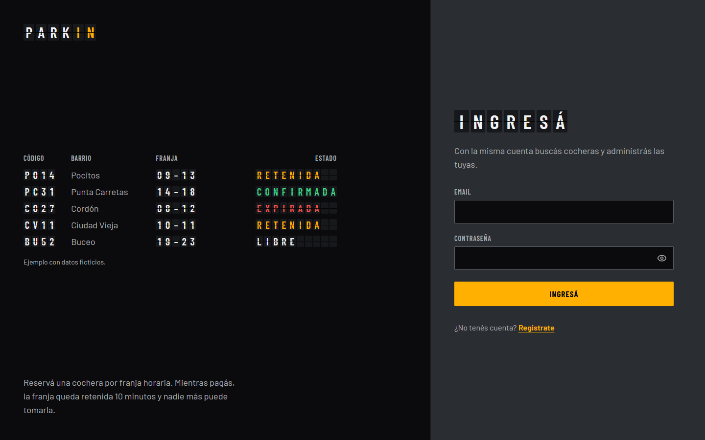
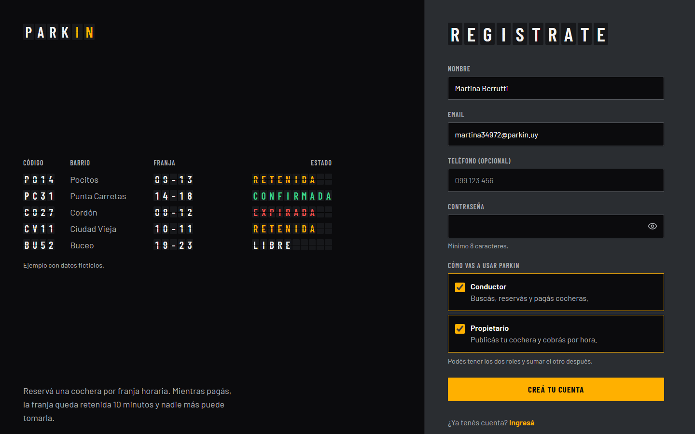

En Perfil se editan los datos de contacto, se suma el otro rol y se puede cerrar la sesión en todos los dispositivos (por ejemplo, si se perdió el celular).

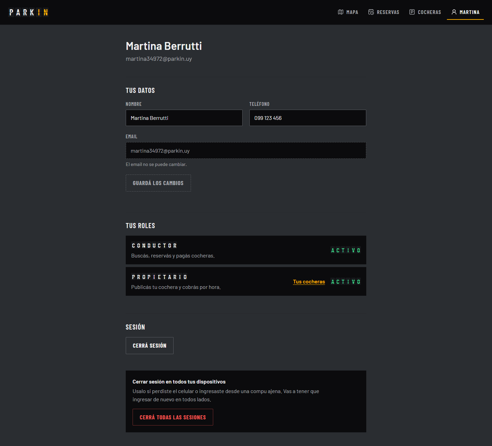

## 2. Alta y gestión de cocheras

El propietario publica una cochera con su título, precio por hora, el vehículo más grande que entra y su dirección, y marca el lugar exacto tocando el mapa. Después define en qué días y horarios se alquila; sin horarios la cochera no aparece en la búsqueda.

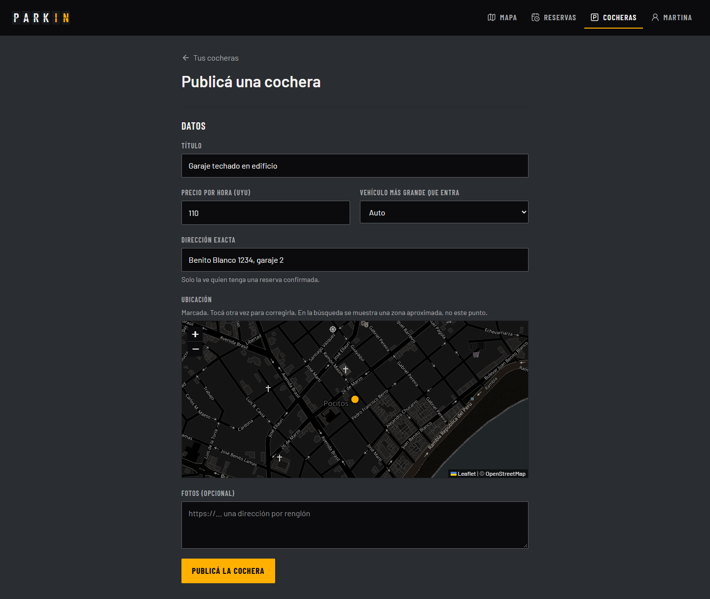
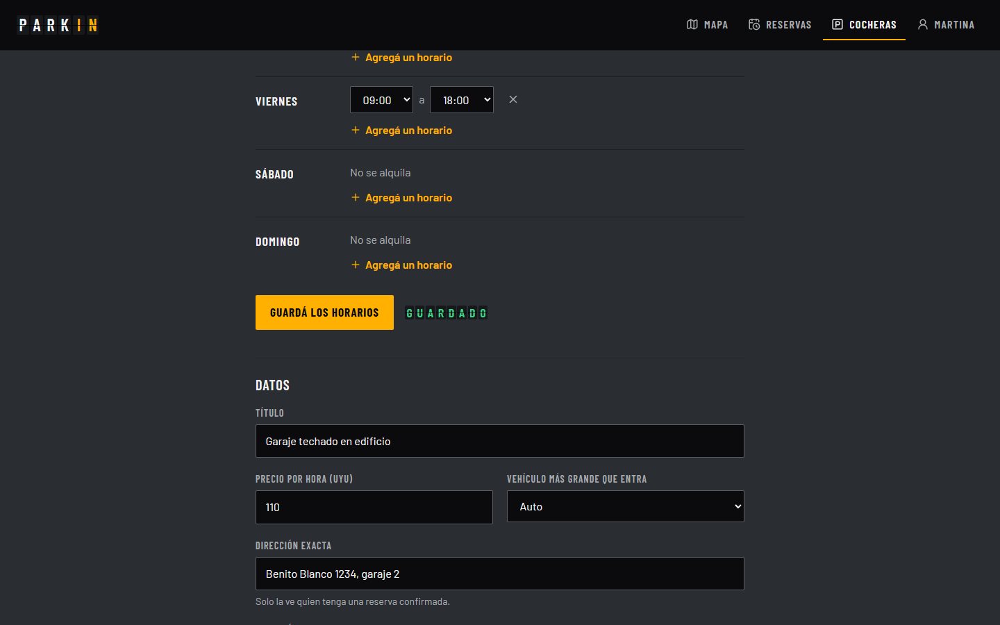
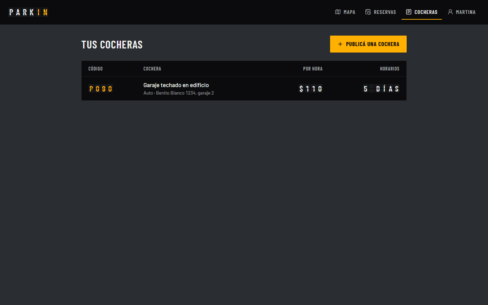

## 3. Búsqueda y reserva por franja

El conductor elige dónde (un barrio o un punto tocado en el mapa), desde y hasta qué hora, y el tipo de vehículo. El mapa y el tablero muestran solo las cocheras libres en toda esa franja. Cada cochera aparece en una **zona aproximada**: la dirección exacta es un dato sensible del propietario y solo se revela con la reserva confirmada.

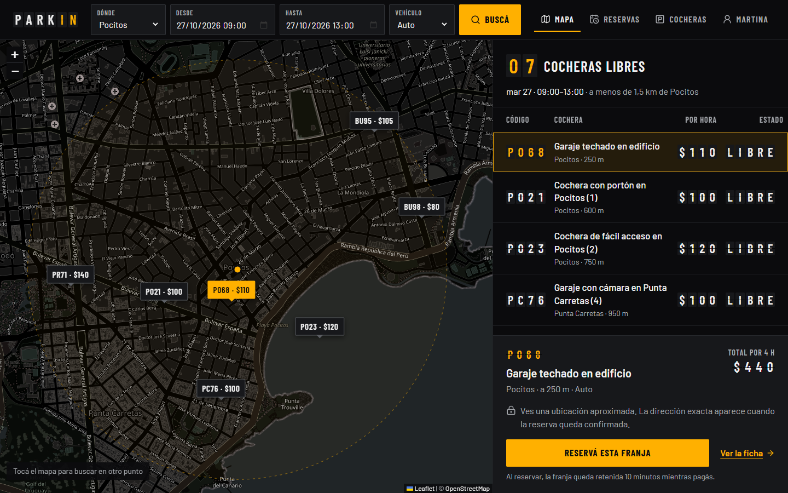
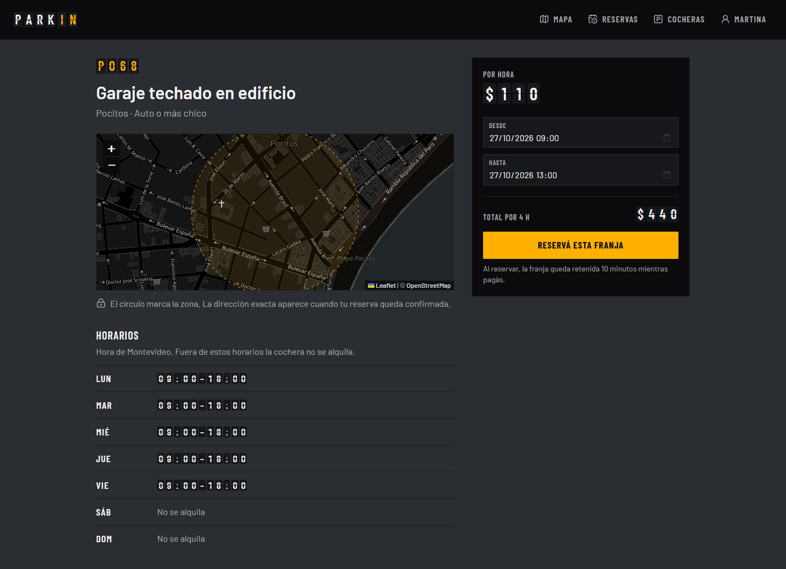

Al reservar, la franja queda **retenida 10 minutos** mientras se paga, con la cuenta regresiva a la vista.

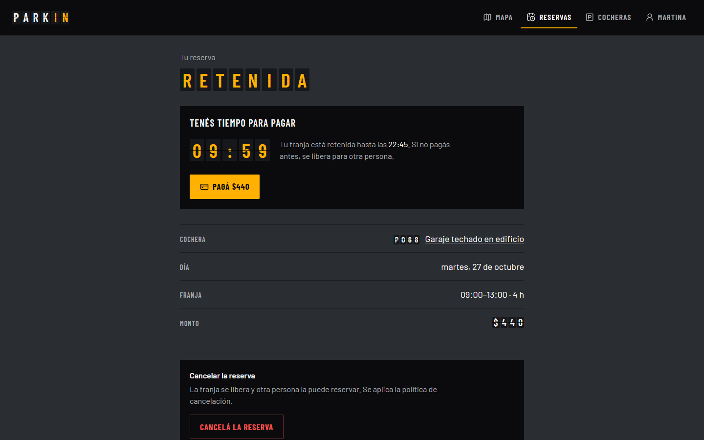

Si otra persona intenta la misma cochera y franja (aunque sea en el mismo instante, desde otro dispositivo), recibe «Esa franja acaba de ser reservada»: la base de datos de Reservas no permite dos reservas activas solapadas.

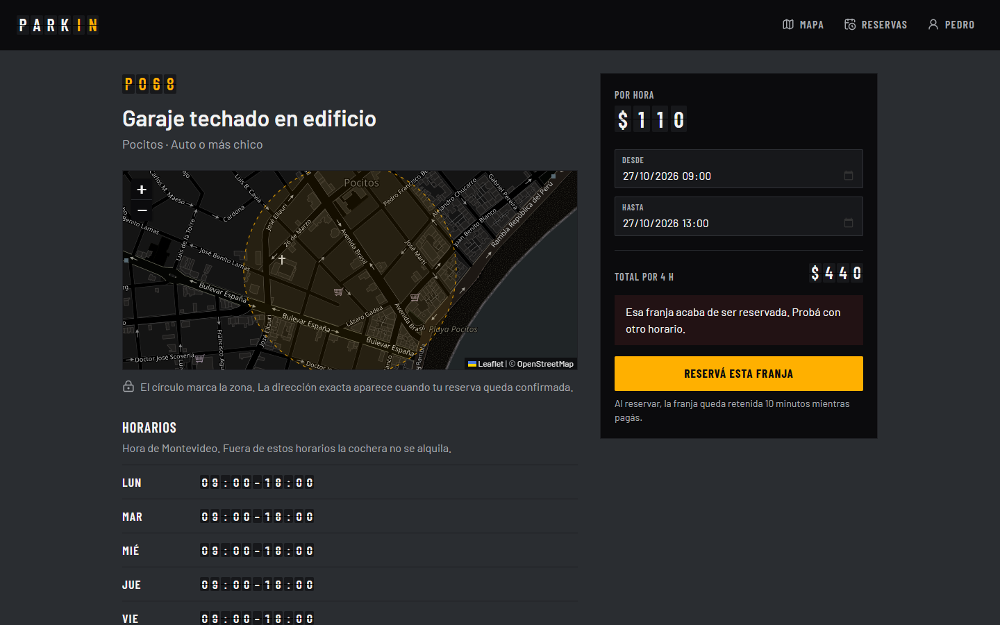

## 4. Pago y notificación

«Pagá» abre la pasarela de pago en otra pestaña. Es una pasarela simulada, que imita el flujo de Mercado Pago (orden, página de pago y aviso firmado a Pagos) sin mover dinero real: ofrece aprobar o rechazar el pago.

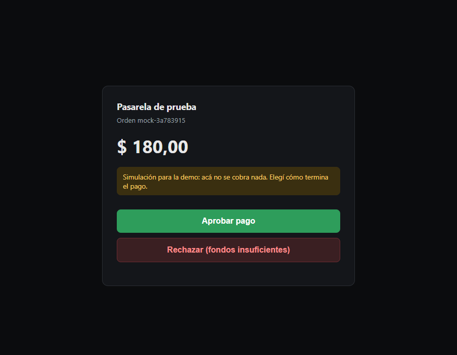

Al aprobar, sin recargar nada, la reserva pasa a **Confirmada**, llega el aviso en tiempo real y aparece la dirección exacta.

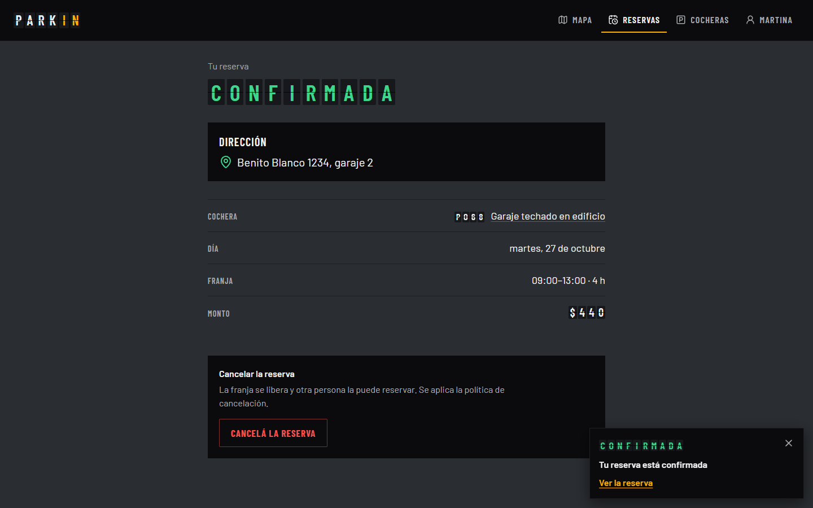

Si el pago se rechaza, la pasarela da la orden por cerrada, llega el aviso, la reserva queda cancelada y la franja se libera para otra persona.

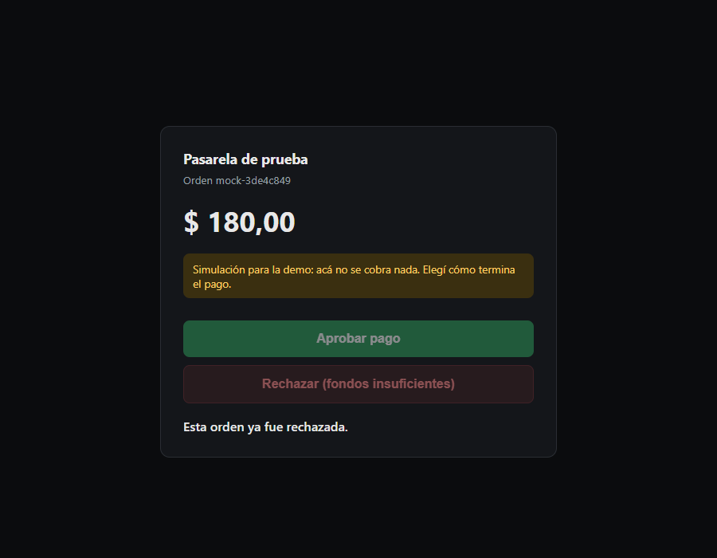

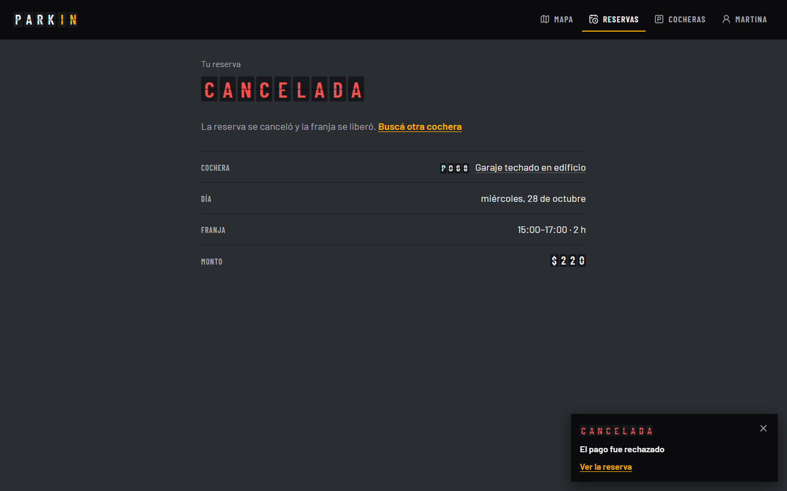

En «Reservas» cada persona ve las que hizo y, si es propietaria, las que recibieron sus cocheras, con su estado.

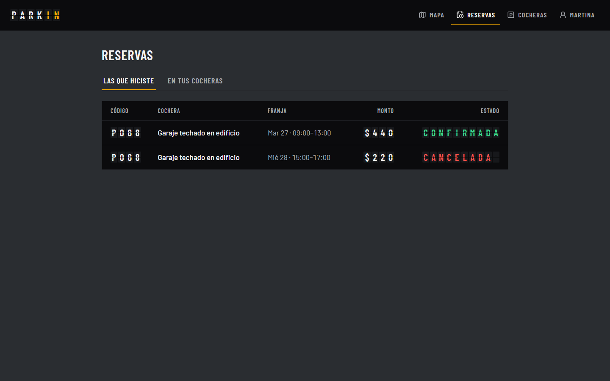

## 5. En el celular

La misma web se adapta al ancho de un teléfono: el mapa arriba y el tablero debajo.

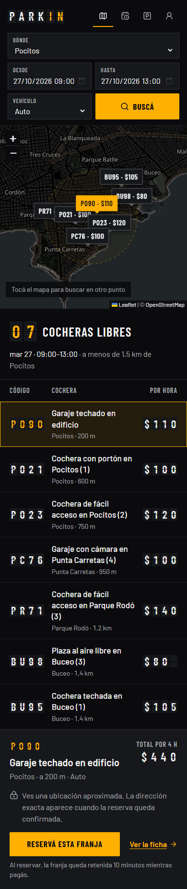
