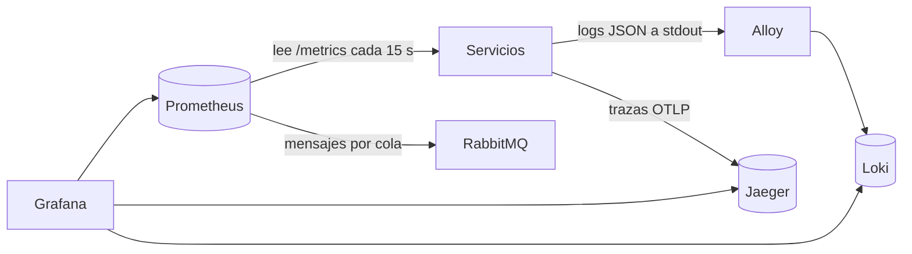
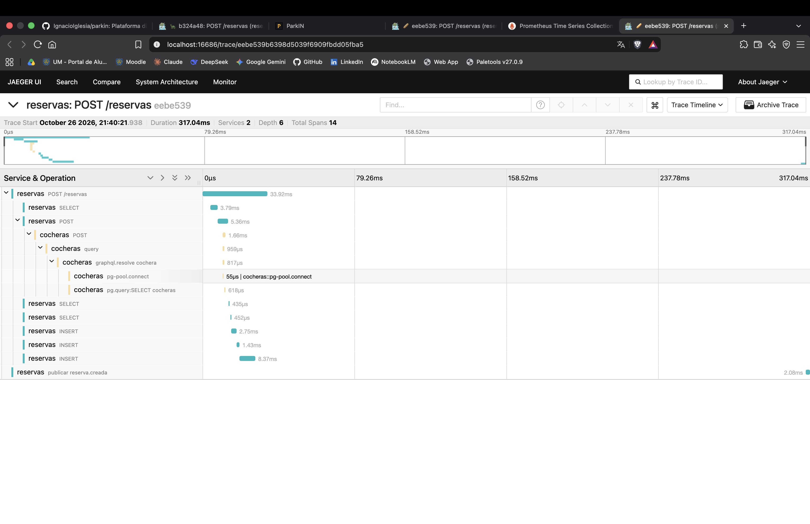
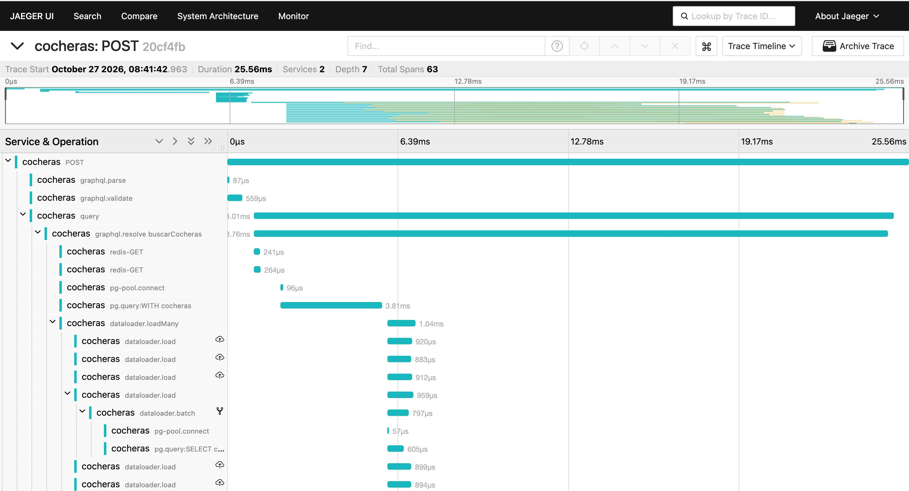
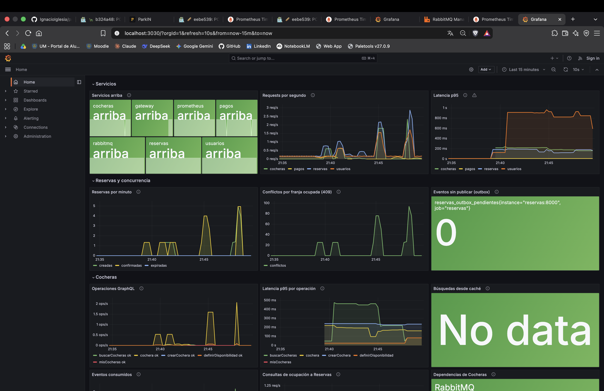
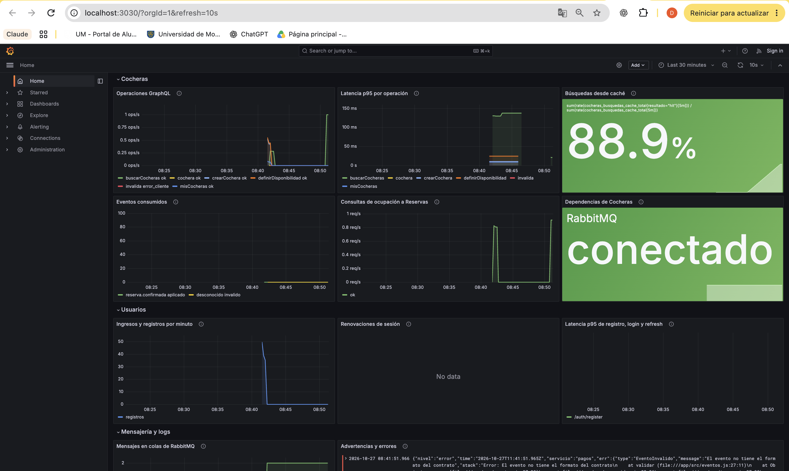
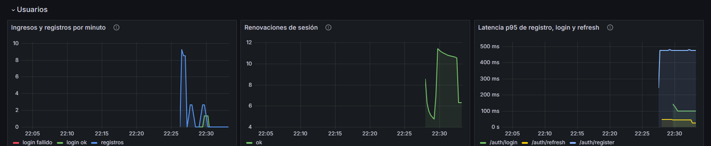
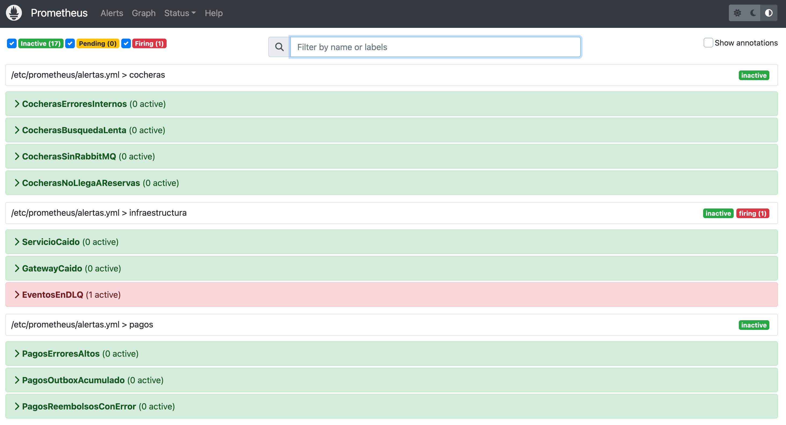
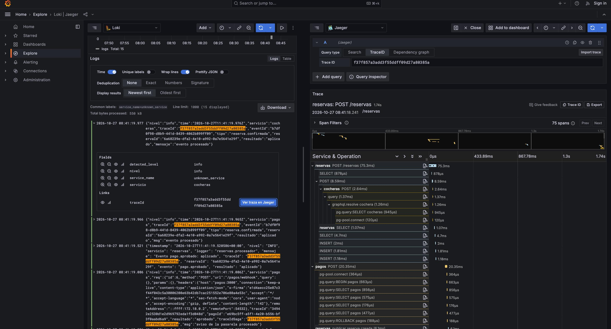

# Observabilidad

> Borrador para el documento final. La referencia completa (métricas, alertas y cómo sumar un servicio) está en `docs/observabilidad.md`. Las capturas `cocheras-*` todavía no están en `docs/capturas/`: se toman con el sistema levantado y después de correr `node scripts/sembrar-cocheras.mjs` y `CONDUCTORES=20 node scripts/demo.mjs`.

La letra pide al menos uno de los pilares de la observabilidad. Implementamos los tres (**logs, métricas y trazas**) y los unimos con un mismo identificador, el `traceId`, para poder pasar de uno a otro.

Distinguimos observabilidad de monitoreo, como en el curso. La observabilidad es la propiedad de poder entender el estado interno del sistema a partir de lo que emite. El monitoreo es usarla: mirar indicadores, detectar patrones y actuar. Las alertas y el tablero son el monitoreo; los logs, métricas y trazas que los alimentan son la observabilidad.

En parkIN hace falta más de un pilar porque un solo pedido recorre varios procesos. Reservar y pagar pasa por el gateway, Reservas, Cocheras, RabbitMQ, Pagos y la pasarela, y la confirmación vuelve por eventos. Si algo falla, el log de un solo servicio no alcanza para saber dónde: hay que poder seguir el recorrido entero.

## Cómo se implementó

Los servicios no conocen a Loki ni a Grafana. Cada uno escribe sus logs en la salida estándar, expone un endpoint de métricas y manda sus trazas a la dirección que le indica una variable de entorno. La infraestructura junta todo. Esto sigue el factor XI de 12-Factor (los logs son un flujo de eventos) y permite sumar un servicio sin tocar la configuración de los demás.

| Pilar | Herramienta | Qué registra cada servicio |
|---|---|---|
| Logs | Alloy y Loki | Una línea JSON por evento, con `nivel`, `servicio`, `mensaje`, `traceId` y, cuando corresponde, `usuarioId`, `cocheraId` o `reservaId`. Nunca contraseñas, tokens ni datos de tarjeta |
| Métricas | Prometheus | Requests y latencia por ruta (con los mismos nombres en todos los servicios, para compararlos en un mismo panel) y métricas de negocio propias |
| Trazas | OpenTelemetry y Jaeger | Un span por request, por consulta a la base, por llamada a otro servicio y por evento publicado o consumido |

Grafana reúne los tres en un solo tablero, que abre como pantalla de inicio. Desde un log se salta a su traza en Jaeger, y desde una traza a los logs de todos los servicios con ese `traceId`.

## Un mismo `traceId` en todo el recorrido

1. El gateway genera el `traceId` (header W3C `traceparent`), lo escribe en su propio log y lo devuelve al cliente en `X-Trace-Id`.
2. Cada servicio continúa esa traza, lo escribe en sus logs y lo propaga cuando llama a otro (Reservas a Cocheras, Cocheras a Reservas).
3. Los eventos de RabbitMQ llevan el `traceId` dentro del mensaje, así que quien los consume sigue en la misma traza. El pago aprobado, la confirmación de la reserva y la dirección habilitada en Cocheras aparecen juntos, aunque ocurrieron en servicios distintos y en momentos distintos.

Con eso, buscar `{servicio=~".+"} |= "<traceId>"` en Loki devuelve el recorrido completo de un pedido, empezando por la línea del gateway.

## Métricas

Además de requests y latencia, cada servicio mide lo que importa en su dominio:

| Servicio | Métricas propias |
|---|---|
| Cocheras | Operaciones GraphQL por resultado (GraphQL responde 200 aunque haya errores, así que se mide aparte), aciertos y fallos de la caché de Redis, consultas de ocupación a Reservas, eventos procesados y estado de RabbitMQ y Redis |
| Reservas | Reservas creadas, confirmadas, canceladas y expiradas; conflictos 409; reintentos de transacción; eventos en el outbox sin publicar |
| Pagos | Pagos creados, aprobados y rechazados; webhooks; reembolsos; outbox; conexiones WebSocket abiertas |
| Usuarios | Registros, logins correctos y fallidos, renovaciones de sesión por resultado (incluidos los tokens reutilizados) |
| Gateway | Estado de NGINX y requests totales, por medio de un exportador |
| RabbitMQ | Mensajes en cada cola, incluida la de mensajes fallidos |

La latencia p95 por servicio es la medida de **calidad de servicio** del sistema: dice cuánto espera el 95 % de los usuarios, y las alertas avisan cuando se pasa del límite que fijamos para las operaciones críticas.

## Alertas

Prometheus evalúa 18 alertas (`infra/prometheus/alertas.yml`). Se agrupan en cuatro tipos:

- **Algo se cayó:** un servicio deja de exponer métricas (`ServicioCaido`), el gateway no responde (`GatewayCaido`), Cocheras pierde la conexión con RabbitMQ o no llega a Reservas.
- **Errores y lentitud:** más de 2 % de errores internos en un servicio, o la p95 por encima del límite (500 ms para la búsqueda y el login, 800 ms para crear una reserva).
- **Mensajes que no avanzan:** eventos en la cola de mensajes fallidos (`EventosEnDLQ`), o un outbox que se acumula porque RabbitMQ no los recibe, aunque la API siga respondiendo bien.
- **Seguridad y negocio:** más de 30 logins fallidos en 5 minutos (posible fuerza bruta), un refresh token reutilizado (posible sesión robada), reembolsos con error o un exceso de reservas que expiran sin pagarse (señal de un problema con Pagos).

## Beneficios: qué nos permitió encontrar

La observabilidad no quedó solo para la demo: encontró dos errores reales durante el desarrollo.

1. **Errores 500 con reservas simultáneas.** Con 10 reservas a la vez sobre la misma franja, en algunas corridas 9 de las 10 respondían 500 en lugar de 409. Los logs de Reservas mostraron que PostgreSQL abortaba las transacciones por *deadlock* en la restricción de exclusión. Nunca hubo doble reserva, pero el usuario recibía un error del servidor en lugar de «franja ocupada». Se corrigió con un lock por cochera: después, 5 corridas de 15 reservas simultáneas dieron siempre una aceptada y 14 conflictos, sin ningún 500. La métrica `reservas_reintentos_transaccion_total` quedó para vigilarlo.
2. **RabbitMQ no arrancaba desde cero.** Con un volumen nuevo, el broker fallaba al importar su configuración. El log del contenedor mostraba el motivo exacto, y se corrigió declarando el virtual host en `infra/rabbitmq/definitions.json`.

Además, la prueba de un evento inválido mostró el camino completo de un fallo: el mensaje terminó en la cola de mensajes fallidos y disparó la alerta `EventosEnDLQ`.

En la operación diaria, cada señal responde una pregunta distinta. Las **métricas** dicen que algo anda mal (sube la latencia, crecen los conflictos o se acumula el outbox). Las **trazas** dicen dónde (qué servicio o qué consulta tarda). Los **logs** dicen por qué (el error exacto).

De los desafíos que plantea el curso, dos se nos presentaron:
- **El monitoreo de microservicios y contenedores,** que resolvimos haciendo que cada servicio emita lo mismo y con los mismos nombres. Por eso un panel compara la latencia de los cuatro.
- **El volumen de datos,** que acotamos no registrando los health checks ni `/metrics`, a los que Docker y Prometheus llaman cada pocos segundos.

## Límites

- El gateway genera el `traceId` y lo escribe en sus logs, pero no exporta spans: en Jaeger la traza empieza en el primer servicio.
- Los eventos llevan el `traceId` pero no el span que los publicó, así que Jaeger muestra su procesamiento dentro de la traza correcta, pero con un aviso de «padre desconocido».
- La pila de observabilidad corre en una sola instancia, con la retención por defecto y Grafana sin login. Alcanza para desarrollo y para la defensa; en producción haría falta autenticación, retención definida y un destino para las alertas (hoy solo se ven en Prometheus).
