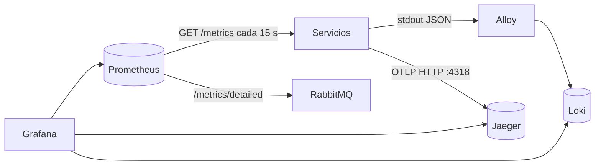

# Observabilidad

La letra pide al menos uno de los pilares. Implementamos los tres (logs, métricas y trazas), unidos por un mismo `traceId`, y Grafana como punto único para consultarlos.

- **Pilares:** logs estructurados (Loki), métricas (Prometheus) y trazas distribuidas (Jaeger).
- **Cómo se implementó:** cada servicio loguea JSON a stdout, expone `GET /metrics` y propaga el header W3C `traceparent`. La infraestructura recolecta todo sin que los servicios conozcan Loki ni Grafana.
- **Qué permitió detectar:** ver [Hallazgos](#hallazgos).

## Arquitectura

| Componente | Qué hace | Configuración |
|---|---|---|
| Alloy | Lee los logs de todos los contenedores de Compose por el socket de Docker y los manda a Loki con las etiquetas `servicio` y `nivel` | `infra/alloy/config.alloy` |
| Loki | Guarda los logs | Imagen por defecto |
| Prometheus | Lee `/metrics` de cada servicio y la cantidad de mensajes por cola de RabbitMQ; evalúa las alertas | `infra/prometheus/` |
| Jaeger | Recibe trazas por OTLP y las muestra | Imagen all-in-one |
| Grafana | Dashboard y consultas. Desde un log se salta a su traza en Jaeger, y desde una traza a los logs de todos los servicios con ese `traceId` | `infra/grafana/` (se carga solo al arrancar) |

## Cómo usarlo

Con `docker compose up --build`:

| Qué | Dónde |
|---|---|
| Dashboard "Parkin" (pantalla de inicio de Grafana) | http://localhost:3030 |
| Seguir una request en todos los servicios | Grafana → Explore → Loki → `{servicio=~".+"} \|= "<traceId>"` |
| Ver la traza de una request | Grafana → Explore → Jaeger, o http://localhost:16686 |
| Alertas activas | http://localhost:9090/alerts |

El `traceId` de una request llega en el header de respuesta `X-Trace-Id` del gateway. Grafana abre sin login (acceso anónimo, solo para desarrollo).

El dashboard muestra: servicios arriba, requests por segundo y latencia p95 por servicio; reservas por minuto y conflictos 409 (la competencia por la misma franja); operaciones GraphQL de Cocheras, aciertos de caché, eventos consumidos y consultas a Reservas; ingresos (correctos y fallidos), registros, renovaciones de sesión por resultado (con los tokens reutilizados en rojo) y latencia de login y refresh en Usuarios; mensajes por cola de RabbitMQ (incluida la DLQ) y los logs de advertencia y error de todos los servicios.

## Cómo sumar un servicio

1. **Logs:** JSON a stdout, una línea por evento, con `nivel`, `servicio`, `mensaje` y `traceId` cuando haya. Alloy los toma solo. Nunca contraseñas, tokens ni datos de tarjeta.
2. **Métricas:** `GET /metrics` en formato Prometheus, con nombres `<servicio>_http_requests_total{metodo,ruta,estado}` y `<servicio>_http_request_duration_seconds`. `ruta` es la plantilla, nunca un id. Así aparecen solos en los paneles de requests y latencia. Después, descomentar el job del servicio en `infra/prometheus/prometheus.yml`.
3. **Trazas:** usar el SDK de OpenTelemetry del lenguaje con `OTEL_EXPORTER_OTLP_ENDPOINT=http://jaeger:4318` y `OTEL_SERVICE_NAME=<servicio>` en el compose. En Node: ver `cocheras/src/telemetria.js`. En Python: `opentelemetry-instrumentation-fastapi` y `opentelemetry-exporter-otlp-proto-http`.
4. **Eventos:** copiar el `traceId` al evento (contratos §7). Quien consume lo usa como padre de su span y la traza sigue en Jaeger.

## Alertas

Además de las de Reservas (más abajo), `infra/prometheus/alertas.yml` define:

| Alerta | Condición |
|---|---|
| `ServicioCaido` | Prometheus no puede leer las métricas de un servicio durante 1 minuto |
| `GatewayCaido` | El exportador no puede leer a NGINX durante 1 minuto (`nginx_up == 0`): el único punto de entrada no responde |
| `EventosEnDLQ` | Hay mensajes en `cocheras.dlq` durante 1 minuto |
| `CocherasErroresInternos` | Más de 2 % de operaciones GraphQL con error interno durante 5 minutos |
| `CocherasBusquedaLenta` | p95 de `buscarCocheras` mayor a 500 ms durante 5 minutos |
| `CocherasSinRabbitMQ` | El consumidor de Cocheras desconectado durante 1 minuto |
| `CocherasNoLlegaAReservas` | Fallan las consultas de ocupación a Reservas durante 5 minutos |
| `UsuariosErroresAltos` | Más de 2 % de errores 5xx en Usuarios durante 5 minutos |
| `UsuariosSesionLenta` | p95 de login y refresh mayor a 500 ms durante 5 minutos (entrar y renovar la sesión se vuelve lento para todos) |
| `UsuariosPosibleFuerzaBruta` | Más de 30 logins fallidos en 5 minutos |
| `UsuariosRefreshReutilizado` | Se reutilizó un refresh token fuera de la ventana de gracia (posible sesión robada) |

## Cocheras (implementado)

**Logs.** JSON a stdout (pino) con `nivel`, `servicio`, `mensaje`, `traceId` y, cuando corresponde, `usuarioId`, `cocheraId` y `reservaId`. Una línea por request. `/health`, `/ready` y `/metrics` no se registran. Los headers `Authorization` y `Cookie` se ocultan.

**Métricas.** `GET /metrics`:

| Métrica | Qué mide |
|---|---|
| `cocheras_http_requests_total{metodo,ruta,estado}`, `cocheras_http_request_duration_seconds` | Requests y latencia, con los mismos nombres que Reservas |
| `cocheras_graphql_operaciones_total{operacion,resultado}` | Cada campo raíz (`buscarCocheras`, `crearCochera`, ...) con `ok`, `error_cliente` o `error_interno`. GraphQL responde 200 aunque haya errores, por eso se mide aparte |
| `cocheras_graphql_duracion_seconds{operacion}` | Latencia por operación |
| `cocheras_busquedas_cache_total{resultado}` | `hit` o `miss` de la caché de Redis |
| `cocheras_consultas_reservas_total{resultado}`, `cocheras_consultas_reservas_duracion_seconds` | Consultas de ocupación a Reservas |
| `cocheras_eventos_procesados_total{tipo,resultado}` | `aplicado`, `duplicado`, `invalido` o `error` |
| `cocheras_cambios_total{operacion}` | Altas, ediciones, cambios de disponibilidad y bajas |
| `cocheras_rabbitmq_conectado`, `cocheras_redis_disponible` | Estado de las dependencias (1 o 0) |

**Trazas.** OpenTelemetry con instrumentación automática de HTTP, GraphQL, pg, Redis, amqplib y fetch, exportada a Jaeger. El span de cada request continúa el `traceparent` del gateway, así que su `traceId` es el mismo que el de los logs. La consulta de ocupación a Reservas propaga el `traceparent`. Al consumir un evento, Cocheras usa el `traceId` que viene dentro del mensaje como padre: el procesamiento aparece en la misma traza que la request que originó la reserva (Jaeger avisa "invalid parent span" porque el evento no trae el id del span padre, solo el de la traza).

Se carga con `node --import ./src/telemetria.js` y solo se activa si está definida `OTEL_EXPORTER_OTLP_ENDPOINT`.

## Hallazgos

Probamos el stack completo con un script que crea una cochera, busca, lanza 10 reservas simultáneas sobre la misma franja, aprueba el pago y manda un evento inválido. Hoy ese recorrido está en `scripts/demo.mjs`, que pasa por el gateway y paga con Pagos y la pasarela simulada. Con un solo `traceId` se ve en Loki y en Jaeger el recorrido entero: búsqueda en Cocheras, consulta de ocupación en Reservas, reserva creada, pago aplicado y dirección habilitada en Cocheras. El evento inválido terminó en `cocheras.dlq` y disparó la alerta `EventosEnDLQ`.

La observabilidad detectó dos problemas:

1. **Deadlock en reservas simultáneas.** En algunas corridas, 9 de las 10 reservas respondieron 500 en lugar de 409. Los logs de Reservas mostraron `psycopg.errors.DeadlockDetected` en el `INSERT`: con varias transacciones esperándose en la restricción de exclusión, Postgres aborta algunas por deadlock. **Nunca hubo doble reserva**: siempre entró una sola, pero el cliente recibía un error de servidor en lugar de "franja ocupada". Ya está corregido (PR #26): las altas sobre una misma cochera hacen fila con un lock por cochera y se reintentan si Postgres aborta la transacción. Con `scripts/demo.mjs`, 5 corridas de 15 reservas simultáneas dieron siempre 1 × 201 y 14 × 409, sin ningún 500.
2. **RabbitMQ no arrancaba desde cero.** `infra/rabbitmq/definitions.json` no declaraba el virtual host ni usuarios, y con un volumen nuevo RabbitMQ fallaba con `Please create virtual host "/" prior to importing definitions`. Ya está corregido (PR #13).

## Reservas (implementado)

Tres señales, todas con el mismo `traceId`.

**Logs.** JSON a stdout, una línea por evento, con `timestamp`, `nivel`, `servicio`, `logger`, `mensaje` y, cuando corresponde, `traceId`, `usuarioId`, `reservaId` y `cocheraId`. Cada request deja una línea con método, ruta, estado y duración (`duracionMs`); `/health`, `/ready` y `/metrics` no se registran porque los llaman Docker y Prometheus cada pocos segundos. Nunca se registran datos de tarjeta ni contraseñas. Nivel configurable con `LOG_LEVEL`.

**Métricas.** `GET /metrics` en formato Prometheus (es interno: el gateway no lo expone).

| Métrica | Qué mide |
|---|---|
| `reservas_http_requests_total{metodo,ruta,estado}` | Requests; la ruta es la plantilla (`/reservas/{reserva_id}`), no el id |
| `reservas_http_request_duration_seconds` | Latencia (histograma, con bucket en 0.8 s) |
| `reservas_creadas_total`, `reservas_confirmadas_total`, `reservas_expiradas_total`, `reservas_finalizadas_total` | Flujo de negocio |
| `reservas_consultas_cocheras_total{resultado}` | Consultas a Cocheras: `ok`, `no_encontrada` o `error` |
| `reservas_canceladas_total{motivo}` | `cancelada_por_usuario` o `pago_rechazado` |
| `reservas_conflictos_total` | Intentos rechazados por franja ocupada (409) |
| `reservas_reintentos_transaccion_total{motivo}` | Altas reintentadas por `DeadlockDetected` o `SerializationFailure`; debería ser casi cero (con el lock por cochera) |
| `reservas_eventos_procesados_total{tipo,resultado}` | `aplicado`, `duplicado`, `ignorado` o `invalido` |
| `reservas_eventos_publicados_total{routing_key}` | Eventos enviados a RabbitMQ |
| `reservas_outbox_pendientes` | Eventos esperando publicarse (sube si RabbitMQ cae) |

Prometheus las recoge desde `infra/prometheus/prometheus.yml` y evalúa las alertas de `infra/prometheus/alertas.yml`: errores 5xx > 2 %, p95 de `POST /reservas` > 800 ms, outbox acumulado y exceso de expiraciones.

**Trazabilidad.** El gateway genera el `traceId` (header W3C `traceparent`); Reservas lo toma, lo devuelve en el header `X-Trace-Id`, lo escribe en cada log y lo copia al campo `traceId` de cada evento que publica. Para seguir una reserva: buscar su `traceId` en los logs de los servicios. **Trazas a Jaeger.** Con `OTEL_EXPORTER_OTLP_ENDPOINT` definido (en Compose, `http://jaeger:4318`), Reservas exporta trazas OpenTelemetry por OTLP/HTTP con `service.name=reservas`. Instrumenta el request (un span hijo del `traceparent` entrante), la llamada a Cocheras (que así continúa la **misma traza**: `reservas POST /reservas` → `cocheras POST` → GraphQL → consulta SQL) y las consultas SQL. Los eventos de RabbitMQ solo llevan el `traceId`, así que su publicación (`publicar reserva.creada`) y su procesamiento (`procesar pago.aprobado`) quedan en esa misma traza con un padre desconocido, igual que en Cocheras. Con las trazas activas, el `traceId` de los logs y de los eventos es el del span, de modo que se puede buscar directamente en Jaeger. Sin la variable no se exporta nada. Pagos también exporta trazas: procesa `reserva.creada` en esta misma traza, y el pago, el webhook y la confirmación quedan en la traza del "Pagar" (ver `docs/secciones/pagos.md`, sección 11).

**Qué permite detectar.** Un pico de `reservas_conflictos_total` indica competencia por las mismas cocheras; `reservas_outbox_pendientes` creciendo, un problema con RabbitMQ aunque la API siga respondiendo bien; muchas expiraciones, un problema con Pagos.

## Usuarios (implementado)

**Logs.** JSON a stdout (`pino`) con `servicio`, `nivel`, `traceId` (del `traceparent` del gateway) y `usuarioId`; una línea por request con método, ruta, estado y `duracionMs`. No se registran `/health`, `/ready`, `/metrics` ni `/auth/verificar` (los llaman Docker, Prometheus y el gateway en cada request). Contraseñas y tokens se eliminan de cualquier log.

**Métricas.** `GET /metrics`, recogido por Prometheus (job `usuarios`). Interno: lo que llega por el gateway trae `X-Forwarded-For` y Usuarios responde 404.

| Métrica | Qué mide |
|---|---|
| `usuarios_http_requests_total{metodo,ruta,estado}` | Requests; la ruta es la plantilla (`/users/:id`) |
| `usuarios_http_request_duration_seconds` | Latencia (histograma, con bucket en 0.8 s) |
| `usuarios_registros_total` | Cuentas nuevas |
| `usuarios_logins_total{resultado}` | `ok` o `fallido` |
| `usuarios_refresh_total{resultado}` | `ok`, `gracia`, `invalido` o `reutilizado` |
| `usuarios_verificaciones_total{resultado}` | Verificaciones de JWT del gateway: `ok`, `anonimo`, `invalido` |

**Trazas.** OpenTelemetry con instrumentación automática de HTTP y pg, exportada a Jaeger igual que Cocheras (`usuarios/src/telemetria.js`, cargado con `node --import`; sin `OTEL_EXPORTER_OTLP_ENDPOINT` no hace nada). El span de cada request continúa el `traceparent` del gateway y su `traceId` es el de los logs y el header `X-Trace-Id`. Un login o un registro se ve como `POST` → consultas SQL. `/auth/verificar` no se traza: el gateway lo llama en cada request y llenaría Jaeger de trazas de una línea; se sigue en `usuarios_verificaciones_total` y en la alerta `UsuariosVerificacionLenta`. Las consultas de la migración al arrancar tampoco, porque no pertenecen a ninguna request.

**Qué permite detectar.** Un pico de `usuarios_logins_total{resultado="fallido"}` indica un ataque de fuerza bruta (además del rate limiting del gateway); cualquier `usuarios_refresh_total{resultado="reutilizado"}` es una sesión posiblemente robada; muchas verificaciones `invalido` apuntan a un front con tokens vencidos que no refresca.

## Gateway (implementado)

**Logs.** Una línea JSON por request (`log_format json` en `gateway/nginx.conf`) con los mismos campos que los servicios: `nivel`, `servicio` (`gateway`), `msg`, `traceId` y `usuarioId` (el del JWT validado; vacío si no hay token). Además trae `metodo`, `ruta` (la que pidió el cliente, sin query), `estado`, `duracionMs`, `bytes`, `upstream` (a qué contenedor fue) e `ip`. El `nivel` sale del estado: `error` para `5xx`, `warn` para `4xx` y `info` para el resto, así que en Loki `{servicio="gateway", nivel="warn"}` muestra los `401` y los `429`. No se registra `/health` (lo llama Docker cada 10 s), y nunca se loguean headers, cuerpos ni la query.

Como el gateway es el que genera el `traceId`, su línea es la primera del recorrido: `{servicio=~".+"} |= "<traceId>"` trae la línea del gateway y la de cada servicio por el que pasó el pedido.

El log de errores de NGINX (desde `warn`, incluye los tokens que `jwt.js` rechaza por mal formados) no puede ser JSON. Alloy le saca el nivel del texto con una etapa `stage.regex` en `infra/alloy/config.alloy`, así que también se filtra con `{servicio="gateway", nivel="warn"}`.

**Métricas.** `stub_status` de NGINX en el puerto interno `8088` (no publicado en el host), traducido por el contenedor `gateway-exporter` (`nginx-prometheus-exporter`) y leído por Prometheus como job `gateway`: `nginx_up`, `nginx_http_requests_total` y conexiones activas, aceptadas y atendidas. La alerta `GatewayCaido` (`nginx_up == 0` durante 1 minuto) avisa si el único punto de entrada deja de responder. Son totales: los errores por código se ven en los logs.

**Qué permite detectar.** Un pico de `warn` con `estado` `401` indica tokens vencidos o un intento de acceso sin sesión; con `429`, alguien superando el rate limiting. Un `502` en `upstream` vacío o con un servicio puntual indica que ese servicio está caído aunque el resto responda.
