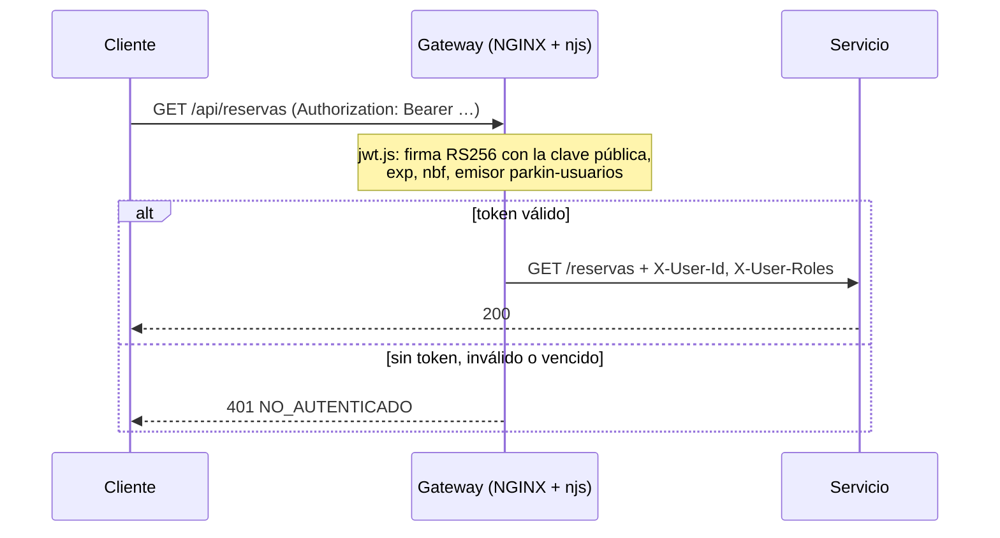

# API Gateway

Sección del documento final. Describe lo que está implementado en `gateway/`. Lo provisorio o pendiente está en la sección 10.

## 1. Responsabilidad

El gateway es el **único punto de entrada** del sistema: el front y cualquier cliente externo hablan solo con él. Rutea cada pedido al servicio que corresponde, valida el JWT una sola vez, pasa la identidad a los servicios, limita la cantidad de pedidos, resuelve CORS y genera el `traceId`. Los servicios no se exponen a internet: dentro de la red de Docker cada uno solo recibe lo que el gateway le reenvía.

| | |
|---|---|
| Tecnología | NGINX 1.27 (alpine) + módulo njs (JavaScript dentro de NGINX) |
| Archivos | `nginx.conf` (rutas y políticas), `jwt.js` (validación del token), `snippets/` (bloques comunes) |
| Puerto | `8080` en el host |

## 2. Rutas

| El cliente llama | Va a | Token | Notas |
|---|---|---|---|
| `/api/usuarios/auth/*` | `usuarios:/auth/*` | No | Registro, login y refresh: todavía no hay token. Login con límite propio |
| `/api/usuarios/.well-known/*` | `usuarios` | No | Clave pública en JWKS |
| `/api/usuarios/*` (resto) | `usuarios` | **Obligatorio** | Perfil y roles |
| `/api/reservas/*` | `reservas:/reservas/*` | **Obligatorio** | |
| `/api/pagos/webhook` | `pagos:/pagos/webhook` | No | Lo llama la pasarela; Pagos verifica la firma HMAC |
| `/api/pagos/*` | `pagos:/pagos/*` | **Obligatorio** | |
| `/graphql` | `cocheras:/graphql` | Opcional | Buscar es público; crear o editar exige el rol, que valida Cocheras |
| `/ws` | `pagos:/ws` | En el handshake | Socket.IO; el token lo verifica Pagos al conectar |
| `/pasarela/checkout/*` | `pasarela-mock` | No | Solo demo: página de pago y botón de resultado |
| `/health` | el propio gateway | No | Healthcheck de Docker |

El gateway quita el prefijo `/api/<servicio>`: cada servicio expone sus rutas sin saber que hay un gateway delante.

Los upstreams se resuelven con el DNS interno de Docker **en cada request** (`resolver 127.0.0.11` y el upstream en una variable). Así el gateway arranca aunque un servicio todavía no esté levantado: ese servicio responde `502` hasta que aparece, y el resto sigue funcionando.

## 3. Autenticación: validar el JWT en el gateway

**Por qué en el gateway.** Usuarios es el único que **firma** los tokens (con la clave privada). Verificarlos solo requiere la clave **pública**, que no es secreta. El gateway la tiene montada solo de lectura (`infra/jwt/jwt_public.pem`) y verifica cada token localmente, sin llamar a Usuarios en cada request. Si Usuarios se cae, el resto del sistema sigue funcionando para quien ya tiene sesión.

**Por qué njs.** El NGINX de código abierto no valida JWT (eso viene en NGINX Plus). `jwt.js` lo hace con WebCrypto y corre en una location interna (`/_jwt_obligatorio`, `/_jwt_opcional`) que NGINX consulta con `auth_request`. Esa consulta no sale del gateway. Se evaluaron dos alternativas:

| Opción | Por qué no |
|---|---|
| `auth_request` contra `GET /auth/verificar` de Usuarios | Funcionaba (fue la primera versión), pero suma una llamada por request y hace depender a todo el sistema de Usuarios. El endpoint quedó como alternativa |
| OpenResty (NGINX + Lua) | Reemplaza la imagen oficial de NGINX y agrega otro lenguaje |

**Qué controla `jwt.js`:**
- **Algoritmo:** solo RS256. Rechaza `alg: none` y el cambio de algoritmo (un token HS256 "firmado" con la clave pública).
- **Firma:** la verifica con la clave pública de Usuarios.
- **Fechas y emisor:** `exp` vigente, `nbf` si viene, y `iss` = `parkin-usuarios`.
- **Contenido:** `sub` tiene que ser un UUID y los roles se filtran a `PROPIETARIO` y `CONDUCTOR`. Como esos valores terminan en headers HTTP, no se acepta ningún formato que permita inyectar nada.
- **Sin clave pública:** si no la puede leer, **falla cerrado**. Responde `503 AUTH_NO_DISPONIBLE` y no deja pasar ningún pedido protegido.

## 4. Identidad hacia los servicios

Si el token es válido, el gateway agrega dos headers: `X-User-Id` (el `sub`) y `X-User-Roles` (por ejemplo, `PROPIETARIO,CONDUCTOR`). Reservas y Cocheras confían en ellos para saber quién pide y con qué rol.

**Nadie puede hacerse pasar por otro.** El gateway **siempre pisa** esos dos headers con lo que sale del token validado. Si el cliente los manda, se descartan. En rutas públicas, o sin token, quedan vacíos. Como los servicios no se exponen al host salvo para desarrollo, solo el gateway puede ponerlos.

Pagos vuelve a verificar el JWT por su cuenta (defensa en profundidad), porque el WebSocket manda el token en el handshake y no en un header.

**Evidencia** (todo a través del gateway):

| Caso | Resultado |
|---|---|
| `/api/pagos` sin token | `401 NO_AUTENTICADO` |
| `X-User-Id` falso sin token | `401` |
| Token con `alg: none` | `401` |
| Token con el `sub` cambiado (firma rota) | `401` |
| Token válido | Pasa al servicio (`200`) |
| `crearCochera` como `CONDUCTOR` | `FORBIDDEN`: los roles llegan a Cocheras |
| `crearCochera` como `PROPIETARIO` | Creada |
| Mutación de Cocheras sin token | `UNAUTHENTICATED` |
| `/graphql` anónimo | `200`: la búsqueda sigue siendo pública |

## 5. Rate limiting

| Zona | Límite | Dónde |
|---|---|---|
| `general` | 20 pedidos por segundo por IP, ráfaga de 40 | Todo el gateway |
| `login` | 10 por minuto por IP, ráfaga de 5 | `POST /api/usuarios/auth/login` |

Lo que excede el límite recibe `429` sin llegar al servicio. El límite del login frena la fuerza bruta de contraseñas.

**Evidencia:** 20 logins seguidos desde la misma IP. Los 6 primeros llegaron a Usuarios (el pedido inicial más la ráfaga de 5) y recibieron `401`; los otros 14 los cortó el gateway con `429`.

## 6. CORS

El front puede estar en otro dominio (Vercel) que el gateway, así que el navegador pregunta antes de cada pedido con `Authorization` o JSON (preflight `OPTIONS`). El gateway responde ese preflight él mismo, con `204` y sin pedir token, y solo devuelve `Access-Control-Allow-Origin` para orígenes permitidos: `https://*.vercel.app`, `http://localhost:*` y `http://127.0.0.1:*`. Para cualquier otro origen no manda el header y el navegador bloquea la respuesta. Si un servicio manda sus propios headers de CORS, se descartan: el gateway es el único que decide.

**Evidencia:** un preflight desde `https://parkin-web.vercel.app` recibe el origen permitido; uno desde `https://sitio-malicioso.com`, ninguno.

## 7. Trazabilidad

Si el cliente no manda `traceparent` (W3C), el gateway lo genera a partir de su `$request_id`. Lo reenvía a cada servicio, y los servicios lo propagan en sus llamadas y dentro de cada evento de RabbitMQ. Así un pedido se puede seguir por todos los servicios con un único `traceId`. El gateway lo devuelve en el header `X-Trace-Id` (expuesto por CORS para que el front lo pueda mostrar o loguear).

**Logs.** Cada request deja una línea JSON con los mismos campos que los servicios (`nivel`, `servicio`, `traceId`, `usuarioId`), más método, ruta original sin query, estado, `duracionMs` y a qué contenedor fue. El `nivel` sale del estado (`warn` para `4xx`, `error` para `5xx`). Alloy los manda a Loki igual que los de los servicios, así que buscando un `traceId` aparece primero la línea del gateway y después la de cada servicio por el que pasó. No se loguea `/health` ni, nunca, headers, cuerpos o la query.

**Evidencia:** un pedido con `traceparent` propio quedó en el log del gateway con ese `traceId` y el `usuarioId` del token, y la búsqueda de ese `traceId` en Loki devolvió la línea del gateway y la de Reservas. Un `401` y un `404` quedaron con `nivel: warn`, y ni el token ni la query aparecen en ninguna línea.

## 8. WebSocket y pasarela de prueba

**`/ws`.** Hace proxy de Socket.IO hacia Pagos con `Upgrade` y `Connection: upgrade`, y un `proxy_read_timeout` de una hora para que las conexiones abiertas no se corten. El token no viaja en un header sino en el handshake, así que no lo valida el gateway: lo verifica Pagos al conectar.

**`/pasarela/checkout/...`.** Solo para la demo. Publica la página de pago de `pasarela-mock` y el botón que decide el resultado, para poder abrir el checkout desde otro dispositivo o con un túnel público. Crear órdenes y reembolsar (`/ordenes`) es de Pagos y **no se expone** (`404`). La expresión regular de la location solo acepta ids de orden válidos. Con una pasarela real esta ruta no existe.

## 9. Fallas

| Situación | Qué responde el gateway |
|---|---|
| Servicio caído o todavía no levantado | `502` en sus rutas; el resto sigue funcionando |
| No puede leer la clave pública | `503 AUTH_NO_DISPONIBLE` en las rutas protegidas (falla cerrado) |
| Sin token o token inválido en ruta protegida | `401 NO_AUTENTICADO` con `WWW-Authenticate: Bearer` |
| Exceso de pedidos | `429` |

En el compose, el gateway espera a que el servicio `jwt-claves` termine de generar las claves (`service_completed_successfully`). Si el archivo de la clave no existiera al crear el contenedor, Docker crearía una carpeta con ese nombre y el arranque desde cero fallaría.

## 10. Provisorio o pendiente

- **Log de errores.** El log de acceso es JSON, pero los avisos de `jwt.js` (tokens rechazados) y los errores internos de NGINX salen por el log de errores, que NGINX solo escribe en texto.
- **Métricas.** El gateway no expone métricas propias. Los servicios sí, así que las tasas de error y la latencia se ven por servicio.
- **Varias réplicas de Pagos.** El contrato menciona *sticky sessions* para `/ws`. Hoy no hacen falta: hay una sola réplica, y con transporte WebSocket la conexión queda fija en una réplica. Si se escala Pagos y algún cliente usa *long polling*, habría que agregar `ip_hash` o `hash` en un `upstream`.
- **Puertos de desarrollo.** El compose todavía expone algunos servicios directo en el host (por ejemplo, Pagos en `8084`) para probarlos sin gateway. En un despliegue real solo se publicaría el gateway.
