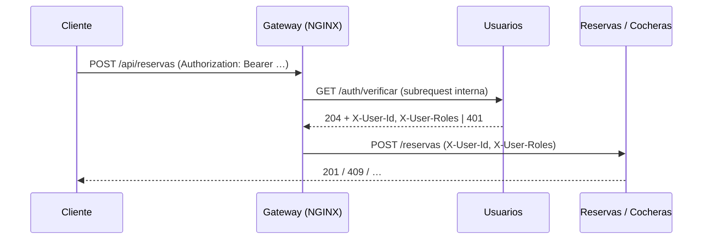

# Servicio de Usuarios

Sección del documento final. Describe lo que está implementado en `usuarios/`. Lo provisorio o pendiente está en la sección 9.

## 1. Responsabilidad

Usuarios registra cuentas, autentica, emite los tokens de sesión y administra perfiles y roles (`PROPIETARIO`, `CONDUCTOR`; una misma cuenta puede tener los dos). Es el único servicio que conoce contraseñas y el único que firma JWT. No participa de eventos: los demás servicios confían en la identidad que les pasa el gateway después de validar el token.

| | |
|---|---|
| Lenguaje y framework | Node.js 24 + Express 5 |
| Base de datos | PostgreSQL (propia, `db-usuarios`) |
| Acceso a datos | `pg` con pool de conexiones, SQL explícito, migraciones `.sql` numeradas |
| Contraseñas | bcrypt (`bcryptjs`, 10 rondas) |
| Tokens | JWT RS256 (`jsonwebtoken`) + refresh token opaco |
| Validación | `zod` (errores → `422` con detalle por campo) |
| Logs y métricas | `pino` (JSON a stdout), `prom-client` |

## 2. API

| Método | Endpoint | Descripción |
|---|---|---|
| POST | `/auth/register` | Crea la cuenta con sus roles y devuelve la sesión |
| POST | `/auth/login` | Devuelve access token (15 min) y refresh token |
| POST | `/auth/refresh` | Rota el refresh token y devuelve una sesión nueva |
| POST | `/auth/logout` | Revoca ese refresh token |
| POST | `/auth/logout-todos` | Revoca todas las sesiones de la cuenta |
| GET | `/auth/verificar` | Uso interno del gateway: valida el JWT y devuelve la identidad en headers |
| GET / PATCH | `/users/me` | Perfil del usuario autenticado; actualiza nombre y teléfono |
| POST | `/users/me/roles` | Suma un rol y devuelve un access token con los roles nuevos |
| GET | `/users/{id}` | Perfil público mínimo (`id`, `nombre`) |
| GET | `/.well-known/jwks.json` | Clave pública en formato JWKS |
| GET | `/health`, `/ready`, `/metrics` | Proceso vivo, base alcanzable, métricas Prometheus |

Errores con un formato único: `{ "error": { "codigo", "mensaje", "detalles"? } }`. Códigos: `201` registro, `401` credenciales o token inválidos, `409` email en uso, `422` datos inválidos.

## 3. Datos

| Tabla | Contenido |
|---|---|
| `usuario` | `id` (UUID), `email` (UNIQUE, en minúsculas), `password_hash`, `nombre`, `telefono` |
| `usuario_rol` | (`usuario_id`, `rol`) con `CHECK` de los dos roles válidos |
| `refresh_token` | `token_hash` (UNIQUE), `expira_en`, `revocado`, `rotado_en` |

Las migraciones se aplican al arrancar. Toman un `pg_advisory_lock`, así que dos réplicas que arrancan al mismo tiempo no migran en paralelo.

## 4. Sesión: access token y refresh token

**Access token (JWT RS256, 15 minutos).** Lleva `sub` (id del usuario), `roles`, `email`, `iss` y en el header un `kid`. Se firma con la clave privada, que solo tiene Usuarios; cualquiera puede verificarlo con la pública. Con HS256 cada servicio que verifica necesitaría el mismo secreto que firma.

**Refresh token (opaco, 7 días).** Es un valor aleatorio de 32 bytes. En la base se guarda solo su SHA-256: si la base se filtra, los tokens no sirven.

**Rotación con detección de reuso.** Cada refresh token sirve una sola vez: al usarlo se revoca y se entrega uno nuevo. Si llega uno ya usado, se asume que fue robado y se revocan **todas** las sesiones de la cuenta (el ladrón y la víctima tienen que volver a ingresar).

**Ventana de gracia (30 s).** Al probar el front apareció un caso real: si el navegador recarga justo durante un refresh, el servidor ya rotó el token pero el navegador no llegó a guardar el nuevo; al volver, presenta el viejo y la detección cerraba todas las sesiones. Ahora un token rotado hace menos de `REFRESH_TOKEN_GRACIA_SEG` se acepta. Logout y logout-todos anulan la gracia. Pasada la ventana, el reuso se sigue tratando como robo (cubierto por tests).

## 5. Integración con el gateway

El NGINX de código abierto no valida JWT por sí mismo (eso viene en NGINX Plus), así que el gateway usa `auth_request`: por cada request a `/api/reservas`, `/api/pagos` y `/graphql` le pregunta a Usuarios. Sin token responde `204` sin identidad (la búsqueda de cocheras es pública); con token inválido o vencido, `401`, y el front refresca la sesión. El gateway descarta siempre los `X-User-Id` y `X-User-Roles` que mande el cliente, así que nadie puede hacerse pasar por otro.

**Costo y alternativa.** Cada request protegido suma una llamada interna a Usuarios (una verificación de firma, sin base de datos). La segunda entrega planteaba que el gateway verificara solo con la clave pública; eso requiere OpenResty (NGINX + Lua) y queda como mejora. Para no depender de esa llamada, Usuarios también publica la clave en JWKS.

**Evidencia** (prueba de punta a punta contra el gateway): sin token, `401`; con `X-User-Id` falso y sin token, `401`; con token de conductor, `crearCochera` responde `FORBIDDEN` (los roles llegan a Cocheras); y **8 conductores reservando a la vez la misma franja: una reserva creada y 7 respuestas `409`**.

## 6. Seguridad

- Contraseñas con bcrypt; nunca se guardan ni se registran en texto plano.
- El login compara contra un hash ficticio cuando el email no existe: tarda lo mismo y no permite averiguar qué emails están registrados.
- El gateway limita el login a 10 intentos por minuto por IP.
- Las claves las genera el servicio `jwt-claves` del compose la primera vez que se levanta (si ya existen no las toca, para no invalidar las sesiones) y no se commitean (`*.pem` en `.gitignore`).
- `/metrics` es interno: el gateway responde `404` en `/api/usuarios/metrics`.

## 7. Observabilidad

**Logs.** JSON a stdout con `servicio`, `nivel`, `traceId` (tomado del `traceparent` del gateway) y `usuarioId`. Cada request deja una línea con método, ruta, estado y duración. `pino` elimina `password`, `accessToken` y `refreshToken` de cualquier log.

**Métricas** (`GET /metrics`, recogidas por Prometheus):

| Métrica | Qué mide |
|---|---|
| `usuarios_http_requests_total{metodo,ruta,estado}` | Requests (la ruta es la plantilla, `/users/:id`) |
| `usuarios_http_request_duration_seconds` | Latencia |
| `usuarios_registros_total` | Cuentas nuevas |
| `usuarios_logins_total{resultado}` | `ok` o `fallido`; un pico de fallidos indica fuerza bruta |
| `usuarios_refresh_total{resultado}` | `ok`, `gracia`, `invalido` o `reutilizado` (posible robo de sesión) |
| `usuarios_verificaciones_total{resultado}` | Verificaciones del gateway: `ok`, `anonimo`, `invalido` |

## 8. Pruebas

`npm test` corre 14 tests sin base de datos: verificación de JWT (válido, firmado con otra clave, vencido, mal formado, anónimo), validación `422`, `401`, JWKS y métricas. Con `TEST_DATABASE_URL` corren además los de sesión contra Postgres: registro, email repetido, login, rotación, ventana de gracia, logout-todos y detección de reuso fuera de la ventana.

## 9. Provisorio o pendiente

- La configuración del gateway con `auth_request` está probada y documentada en `usuarios/README.md`; la integra Romina en `gateway/nginx.conf`.
- `docs/contratos.md` §3 lista cinco endpoints; los demás de la sección 2 se proponen al contrato por PR.
